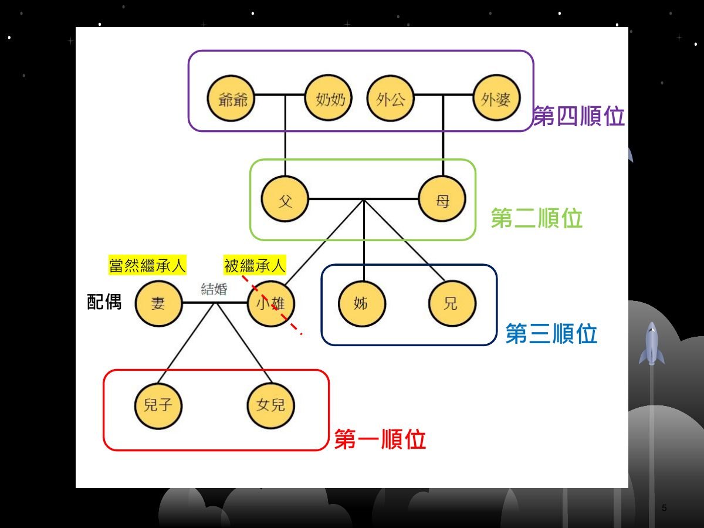
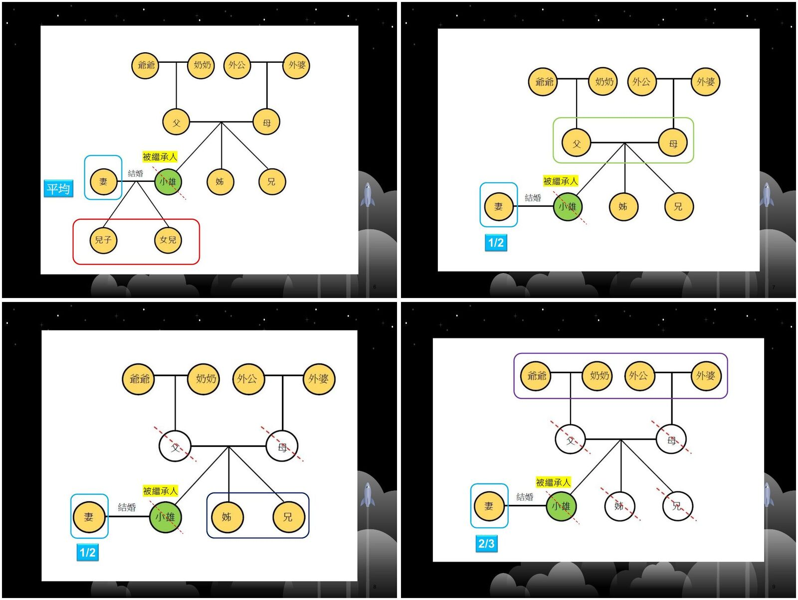
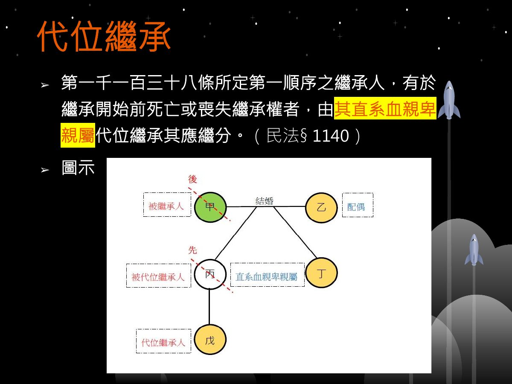
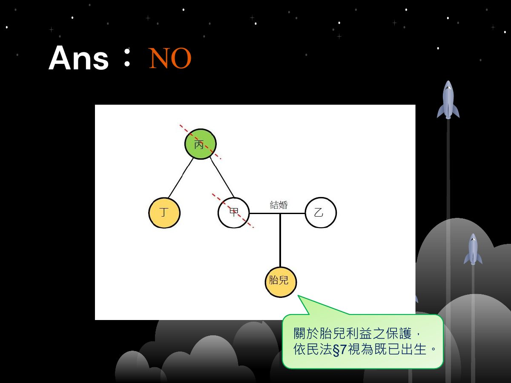
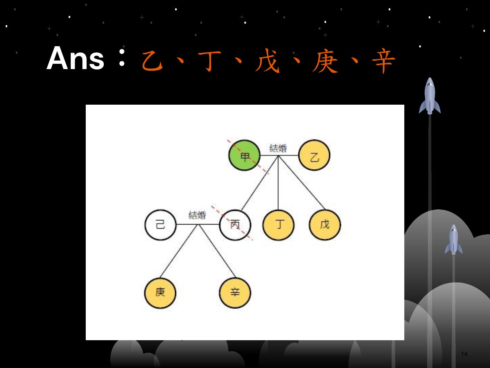
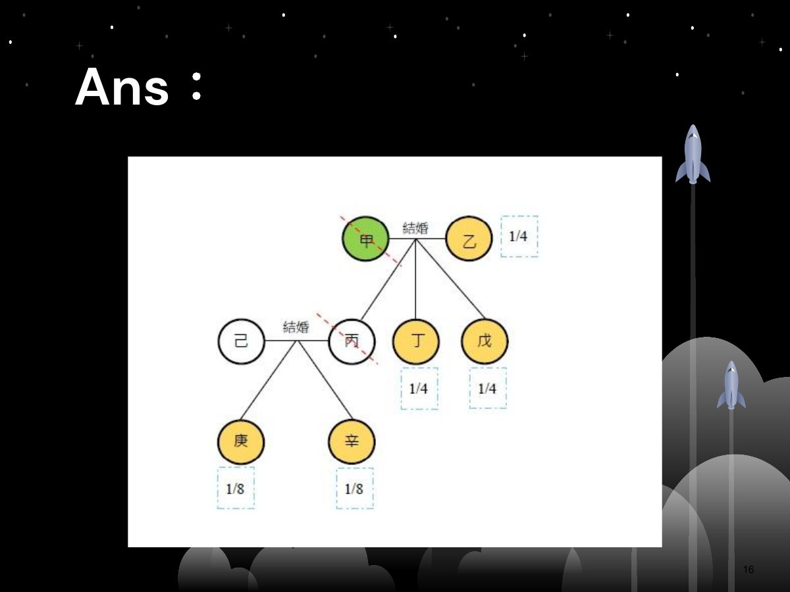
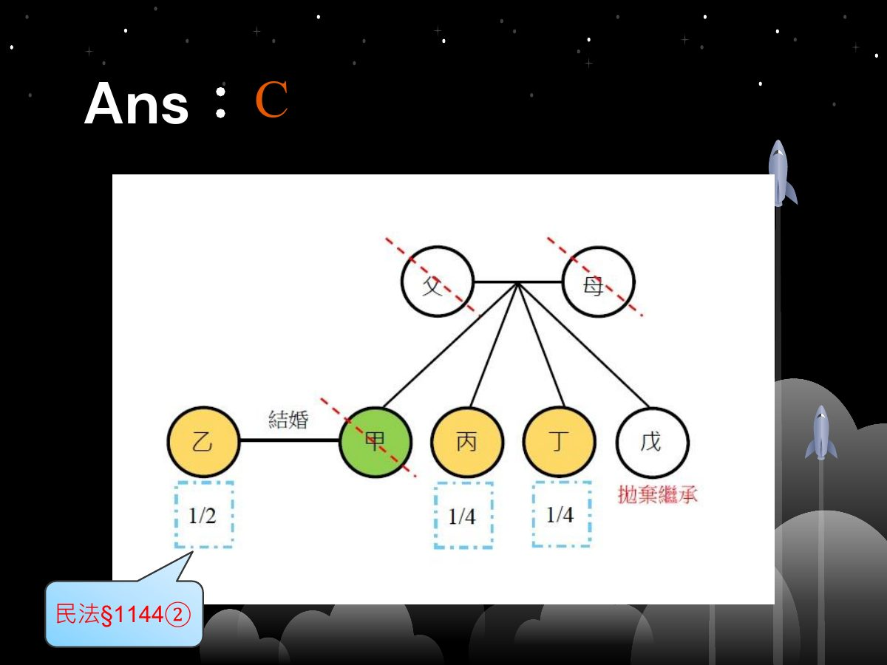
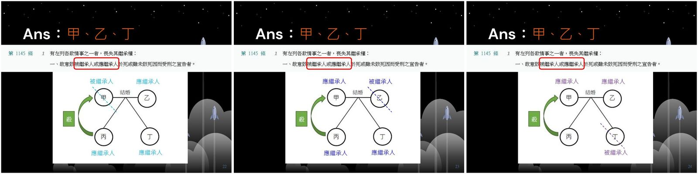
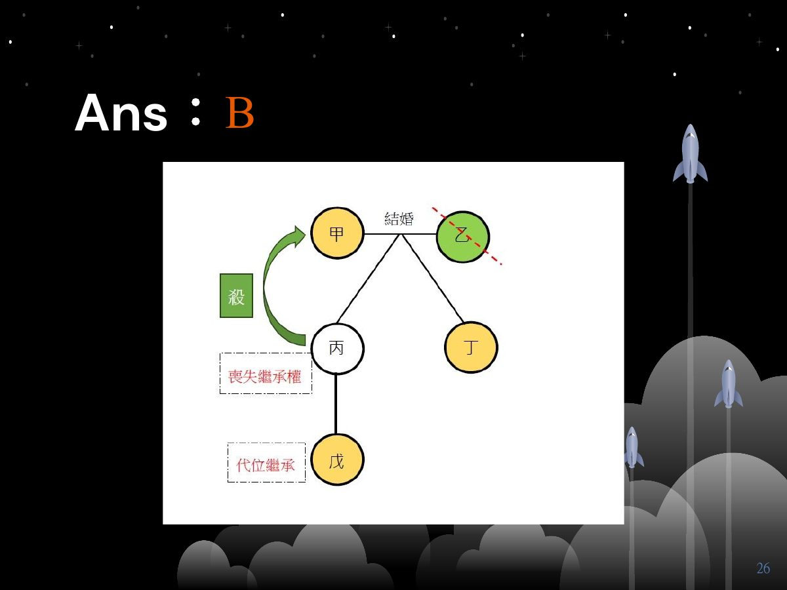
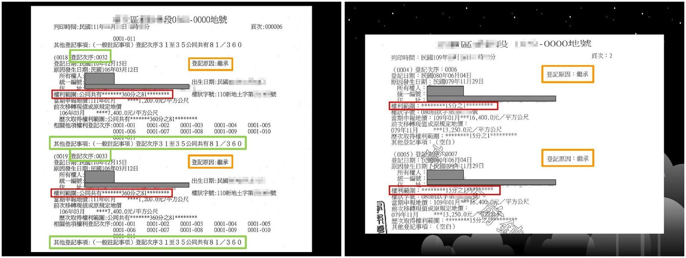

# 性別平權與生活法律（第五週）：繼承（二）

> 王俊怡律師｜115.10.08
>
> 讀法：每段先讀「📘 重點內容」，再做「✏️ 練習題」，最後展開「解答」對答案。
> 「🖼️ 投影片圖示」是直接從 PDF 擷取的投影片圖片。
> 標示「📝 補充」的部分是投影片上沒有寫出、由整理者補上的說明。

---

## 暖身：如何辨別真律師？

### ✏️ 練習題（舉手搶答）

**Q1.** 小玫自稱是位律師，請問你要如何判斷小玫是真的律師，而不是冒牌律師呢？

解答

到 **法務部律師查詢系統** 查詢：https://lawyerbc.moj.gov.tw/

---

## 一、複習繼承順序與應繼分

### 📘 重點內容：繼承順序

🖼️ 投影片圖示：

- **當然繼承人**：配偶
- **第一順位**：直系血親卑親屬（兒子、女兒）
- **第二順位**：父母
- **第三順位**：兄弟姊妹
- **第四順位**：祖父母（爺爺、奶奶、外公、外婆）

### 📘 重點內容：配偶的應繼分

🖼️ 投影片圖示（左上 → 右下：與第一、二、三、四順位共同繼承）：

| 配偶與誰共同繼承 | 配偶的應繼分 |
| --- | --- |
| 第一順位（兒子、女兒） | **平均** |
| 第二順位（父母） | **1/2** |
| 第三順位（兄弟姊妹，父母已死亡） | **1/2** |
| 第四順位（祖父母，父母與兄弟姊妹都已死亡） | **2/3** |

---

## 二、代位繼承

### 📘 重點內容

> 第一千一百三十八條所定第一順序之繼承人，有於繼承開始前死亡或喪失繼承權者，由**其直系血親卑親屬**代位繼承其應繼分。（民法 §1140）

🖼️ 投影片圖示：

- 甲：被繼承人（**後**死亡）
- 丙：被代位繼承人（**先**死亡），是甲的直系血親卑親屬
- 戊：代位繼承人（丙的子女）

### ✏️ 練習題

**Q2.** 甲男乙女結婚，乙懷有身孕，甲不幸因公殉職。甲的父親丙因過度悲傷，不久後生病死亡，留有遺產 2 千萬元。甲的弟弟丁主張丙之遺產由其全部繼承，請問丁的主張有無理由？

解答

**NO**

🖼️ 投影片圖示：

關於胎兒利益之保護，依民法 §7 **視為既已出生**。
📝 說明：甲先於丙死亡，由甲的直系血親卑親屬（胎兒）代位繼承甲的應繼分，所以丙的遺產由丁與胎兒共同繼承，丁不能全部繼承。

**Q3.（動手畫畫看）**
甲、乙為夫妻，有子女丙、丁、戊。丙與己結婚，有子女庚、辛。丙因意外死亡，不久後甲因病死亡。請問甲的遺產應由何人繼承？

解答

**乙、丁、戊、庚、辛**

🖼️ 投影片圖示：

📝 說明：丙先於甲死亡，由丙的子女庚、辛代位繼承；己是丙的配偶，不是甲的直系血親卑親屬，不能代位。

**Q4.** 承上題，請問各繼承人應繼分為何？

解答

| 繼承人 | 應繼分 |
| --- | --- |
| 乙 | 1/4 |
| 丁 | 1/4 |
| 戊 | 1/4 |
| 庚 | 1/8 |
| 辛 | 1/8 |

🖼️ 投影片圖示：

📝 說明：配偶乙與第一順位（丙、丁、戊）平均，各 1/4；丙的 1/4 由庚、辛平分，各 1/8。

**Q5.（舉牌搶答，答對加 2,000 分）**
甲、乙為夫妻，膝下無子。甲有兄弟丙、丁、戊三人。甲的父母都已過世。甲因車禍死亡，弟弟戊依法向法院拋棄繼承。請問甲的遺產應如何繼承？

- A）乙單獨繼承全部。
- B）乙、丙、丁應繼分各 1/3。
- C）乙應繼分 1/2，丙、丁應繼分各 1/4。
- D）乙應繼分 2/3，丙、丁應繼分各 1/6。

解答

**C）乙應繼分 1/2，丙、丁應繼分各 1/4。**（民法 §1144②）

🖼️ 投影片圖示：

---

## 三、喪失繼承權

### 📘 重點內容

> **民法第 1145 條**
> 1. 有左列各款情事之一者，喪失其繼承權：
>    一、故意致**被繼承人或應繼承人**於死或雖未致死因而受刑之宣告者。
>    二、以詐欺或脅迫使被繼承人為**關於繼承之遺囑**，或使其撤回或變更之者。
>    三、以詐欺或脅迫妨害被繼承人為**關於繼承之遺囑**，或妨害其撤回或變更之者。
>    四、偽造、變造、隱匿或湮滅被繼承人**關於繼承之遺囑**者。
>    五、對於被繼承人有重大之虐待或侮辱情事，經被繼承人表示其不得繼承者。
> 2. 前項第二款至第四款之規定，如經被繼承人**宥恕**者，其繼承權不喪失。

| 類型 | 條款 | 說明 |
| --- | --- | --- |
| **絕對失權** | §1145Ⅰ① | 不能宥恕 |
| **相對失權** | §1145Ⅰ②③④ | →「**宥恕**」§1145Ⅱ 可回復 |
| **表示失權** | §1145Ⅰ⑤ | 須經被繼承人表示 |

### ✏️ 練習題

**Q6.（答對加 2,000 分）**
甲、乙為夫妻，有子女丙、丁，丙、丁均未婚無子女。某天，丙與甲爭吵，丙竟持刀殺甲，甲未死，而丙被判刑。5 年後，甲、乙、丁因空難同時死亡。請問丙對何人喪失繼承權？

解答

**甲、乙、丁**

🖼️ 投影片圖示（分別以甲、乙、丁為被繼承人）：

民法 §1145Ⅰ①：故意致「**被繼承人或應繼承人**」於死或雖未致死因而受刑之宣告者。

- 以甲為被繼承人：甲是被繼承人 → 丙失權。
- 以乙為被繼承人：甲是乙的「應繼承人」 → 丙失權。
- 以丁為被繼承人：甲是丁的「應繼承人」 → 丙失權。

**Q7.（答對加 2,000 分）**
甲、乙為夫妻，有子女丙、丁，丙有一子戊。某天丙與甲爭吵，丙持刀殺甲，甲未死，而丙被判刑。5 年後，乙過世，請問乙的遺產應由何人繼承？

- A）甲、丙、丁
- B）甲、丁、戊
- C）丙、丁
- D）丁、戊

解答

**B）甲、丁、戊**

🖼️ 投影片圖示：

- 丙殺害乙的應繼承人甲 → 丙對乙**喪失繼承權**。
- 第一順序繼承人喪失繼承權 → 由其直系血親卑親屬戊**代位繼承**（§1140）。

**Q8.（答對加 3,000 分）**
甲中年喪妻，有子女乙、丙、丁。乙曾脅迫甲立遺囑遺贈乙 1 千萬元。丙在甲死亡後，將甲的部分遺產予以隱匿。請問甲的遺產應由誰繼承？

- A）丁單獨繼承
- B）乙、丁共同繼承
- C）丙、丁共同繼承
- D）乙、丙、丁共同繼承

解答

**C）丙、丁共同繼承**

- 乙：§1145Ⅰ② 以脅迫使被繼承人為**關於繼承之遺囑** → 喪失繼承權。
- 丙：隱匿的是「遺產」，不是 §1145Ⅰ④ 的「**關於繼承之遺囑**」→ 不喪失繼承權。

---

## 四、遺產之繼承 —— 1. 繼承之效力

### 📘 重點內容：繼承的開始與效力

> **民法第 1147 條** 繼承，因被繼承人死亡而開始。

> **民法第 1148 條**
> 1. 繼承人自繼承開始時，除本法另有規定外，承受被繼承人財產上之一切權利、義務。但權利、義務專屬於被繼承人本身者，不在此限。
> 2. 繼承人對於被繼承人之債務，以因繼承所得遺產為限，負清償責任。

### 📘 重點內容：繼承之標的

**得為繼承之標的**

- 除一身專屬權外，被繼承人一切財產上之權利
- 占有
- 非屬被繼承人一身專屬的債務

**不得為繼承之標的**

- **一身專屬之權利**，例：扶養請求權、贍養費請求權
- **一身專屬之義務**，例：扶養義務、債務之履行與被繼承人之特定知識、技術相結合者

### 📘 重點內容：繼承之費用（民法 §1150）

- 遺產管理費用
- 遺產分割費用
- 遺囑執行之費用
- 喪葬費用

> **民法第 1150 條** 關於遺產管理、分割及執行遺囑之費用，**由遺產中支付之**。但因繼承人之過失而支付者，不在此限。

### 📘 重點內容：遺產酌給請求權（民法 §1149）

> **民法第 1149 條** 被繼承人生前繼續扶養之人，應由**親屬會議**依其所受扶養之程度及其他關係，酌給遺產。

- **立法意旨**：死後扶養
- **要件**：
  - 被繼承人生前繼續扶養之人
  - 請求人不能維持生活而無謀生能力
  - 被繼承人未為相當贈與
- **順序**：債權人 ＞ 受酌給請求權人 ＞ 受遺贈人

### ✏️ 練習題（舉手搶答，答對加 2,000 分）

**Q9.** 依我國民法的規定，繼承何時開始？

- A）繼承人向法院提出遺產清冊而開始
- B）因繼承人承認繼承而開始
- C）被繼承人死亡而開始

解答

**C）被繼承人死亡而開始**（民法 §1147）

**Q10.** 下列何者不得為繼承之標的？

- A）借款債務之清償義務
- B）因車禍所生之損害賠償義務
- C）作曲家之作為義務

解答

**C）作曲家之作為義務**

屬於「債務之履行與被繼承人之特定知識、技術相結合者」，是一身專屬之義務。

**Q11.** 遺產管理、執行遺囑之費用，應如何支付？

- A）由遺產中支付
- B）由繼承人之固有財產支付
- C）由被繼承人之債權人支付
- D）由繼承人之債權人支付

解答

**A）由遺產中支付**（民法 §1150）

---

## 五、遺產之繼承 —— 2. 共同繼承

### 📘 重點內容：遺產之公同共有

> 繼承人有數人時，在**分割遺產前**，各繼承人對於遺產全部為**公同共有**。（民法 §1151）

→ 各繼承人只有「**潛在應繼分**」。

### 📘 重點內容：遺產之管理、使用收益及處分

- 前條公同共有之遺產，得由繼承人中互推一人管理之。（民法 §1152）
- **Q：由遺產所生之孳息，歸屬何人？** → **共同繼承人**
- 遺產之處分，**原則上應得共同繼承人全體的同意**。
- **Q：遺產中有不動產，如何登記？**

> 繼承人為二人以上，部分繼承人因故不能會同其他繼承人共同申請繼承登記時，得**由其中一人或數人為全體繼承人之利益**，就被繼承人之土地，申請為**公同共有之登記**。其**經繼承人全體同意**者，得申請為**分別共有之登記**。（土地登記規則 §120Ⅰ）

🖼️ 投影片圖示（左：登記原因「繼承」、權利範圍「公同共有」；右：登記原因「繼承」、權利範圍「15 分之 1」的分別共有）：

### ✏️ 練習題

**Q12.（舉手搶答，答對加 2,000 分）**
繼承人有數人，在分割遺產前，各繼承人對於遺產全部為？

- A）分別共有
- B）公同共有
- C）區分所有

解答

**B）公同共有**（民法 §1151）

---

## 六、遺產分割

### 📘 重點內容：遺產分割之自由、限制

> **民法第 1164 條** 繼承人得隨時請求分割遺產。但法律另有規定或契約另有訂定者，不在此限。

> **民法第 1165 條**
> 1. 被繼承人之遺囑，定有分割遺產之方法，或託他人代定者，從其所定。
> 2. 遺囑禁止遺產之分割者，其禁止之效力以**十年**為限。

> **民法第 1166 條**
> 1. 胎兒為繼承人時，非**保留其應繼分**，他繼承人不得分割遺產。
> 2. 胎兒關於遺產之分割，以其母為代理人。

👉 **未保留胎兒應繼分，逕為遺產之分割，分割行為無效。**

- **遺產分割之自由**：繼承人得隨時請求分割遺產。（民法 §1164 本文）
- **遺產分割之限制**：
  - 遺囑禁止分割遺產（民法 §1165Ⅱ）
  - 繼承人協議不分割
  - 保留胎兒之應繼分（民法 §1166）

### 📘 重點內容：遺產分割之方法（3 種）

1. **遺囑指定分割**（民法 §1165Ⅰ）
2. **協議分割**
3. **裁判分割**（前提：不能協議。分割方法意見不一致，或繼承人中有行蹤不明等）

### 📘 重點內容：遺產分割之實行 ① 債務之扣還

- 如果繼承人對被繼承人有債務？
- 繼承人中如對於被繼承人負有債務者，於遺產分割時，應按其債務數額，由該繼承人之應繼分內**扣還**。（民法 §1172）
- **立法意旨**：為方便遺產分割之執行，為期共同繼承人間的**公平**。
- **扣還的方法**：
  - 應繼分 ＞ 債務 → 可受分配
  - 應繼分 ＝ 債務 → 不得分配
  - 應繼分 ＜ 債務 → 不得分配，且須返還債務
  - Q：若為拋棄繼承時？

### 📘 重點內容：遺產分割之實行 ② 生前特種贈與之歸扣

> **民法第 1173 條**（列舉規定：結婚、分居、營業）
> Ⅰ 繼承人中有在繼承開始前因**結婚、分居或營業**，已從被繼承人受有財產之贈與者，**應將該贈與價額加入繼承開始時被繼承人所有之財產中，為應繼遺產**。但被繼承人於贈與時有反對之意思表示者，不在此限。
> Ⅱ 前項贈與價額，**應於遺產分割時，由該繼承人之應繼分中扣除**。
> Ⅲ 贈與價額，依**贈與時**之價值計算。

- **立法意旨**：維護共同繼承人間的公平
- **歸扣的方法**：
  - 特種贈與 ＜ 應繼分 → 可受分配
  - 特種贈與 ＝ 應繼分 → 不得分配
  - 特種贈與 ＞ 應繼分 → ？（有爭議）

### ✏️ 練習題

**Q13.（範例）**
甲中年喪偶，有子女乙、丙、丁三人。甲因乙之結婚贈與 50 萬元，因丙之營業贈與 60 萬元，因丁之分居贈與 70 萬元。甲死亡時，留有財產 300 萬元。請問遺產分割時，原則上，丁可分得？

解答

**90 萬元**

1. **先計算甲的應繼遺產**：甲遺留 300 萬元，並應歸扣乙、丙、丁所受之特種贈與 50 萬元、60 萬元、70 萬元，則甲之應繼遺產數額為 **480 萬元**。
2. **各繼承人應繼分價額**：乙、丙、丁共同繼承，應繼分各為 1/3，即 **160 萬元**。
3. **由應繼分價額扣除特種贈與價額後所得之餘額**：丁已受有 70 萬元之生前特種贈與，則丁實際可分得數額為 90 萬元【計算式：160 萬元 − 70 萬元 = **90 萬元**】。

**Q14.（答對加 2,000 分）**
甲、乙為夫妻，無子女。甲有父丙、母丁。甲生前為父丙之創業，贈與 140 萬元之資金；為母丁六十歲之生日，贈與鑽戒一枚，價值 40 萬元。甲死亡時，留下遺產 660 萬元。請問遺產分割時，丙可分得？

- A）25 萬元
- B）60 萬元
- C）70 萬元
- D）165 萬元

解答

**B）60 萬元**

1. **先計算甲之應繼遺產**：660 萬元 + 140 萬元 = **800 萬元**。
2. **各繼承人應繼分價額**（民法 §1144②、§1141）：乙、丙、丁共同繼承，應繼分分別為 1/2、1/4、1/4。丙之應繼分為 **200 萬元**。
3. **由應繼分價額扣除特種贈與價額後所得之餘額**：200 萬元 − 140 萬元 = **60 萬元**。

📝 說明：給母親的生日鑽戒不是因「結婚、分居或營業」所為的贈與，不必歸扣。

---

## 📋 速記總整理

| 主題 | 一句話記住 |
| --- | --- |
| 查律師 | 法務部律師查詢系統 lawyerbc.moj.gov.tw |
| 配偶應繼分 | 平均 → 1/2 → 1/2 → 2/3 |
| 代位繼承 | 第一順位**先死**或**喪失繼承權** → 其直系血親卑親屬代位（§1140）；配偶不能代位；拋棄繼承不代位 |
| 胎兒 | 視為既已出生（§7）；分割遺產要保留胎兒應繼分，否則分割無效（§1166） |
| 喪失繼承權 | 絕對①、相對②③④（可宥恕）、表示⑤；①包括殺害「應繼承人」 |
| ②③④ 的對象 | 都是「關於繼承之**遺囑**」，隱匿遺產不算 |
| 繼承開始 | 被繼承人死亡（§1147） |
| 不得繼承 | 一身專屬權利義務（扶養、贍養費、與特定技術結合的債務） |
| 繼承費用 | 由遺產中支付（§1150） |
| 遺產酌給 | 死後扶養；債權人 ＞ 受酌給人 ＞ 受遺贈人 |
| 分割前 | 公同共有（§1151），處分要全體同意 |
| 分割方法 | 遺囑指定、協議、裁判；遺囑禁止分割最多 10 年 |
| 扣還 / 歸扣 | 欠被繼承人的債從應繼分扣（§1172）；結婚、分居、營業的贈與要加回再扣（§1173），依贈與時價值 |
