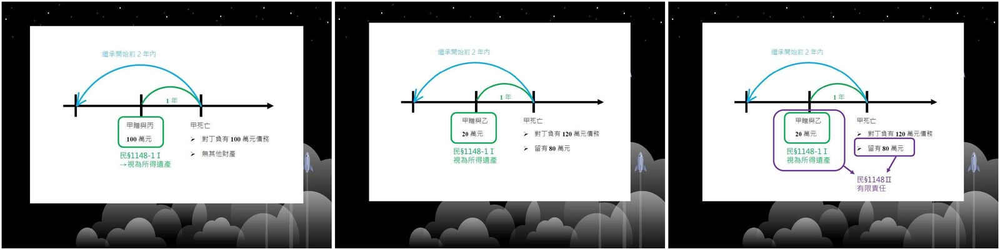
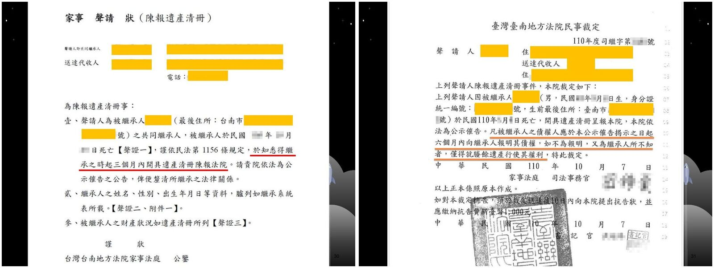
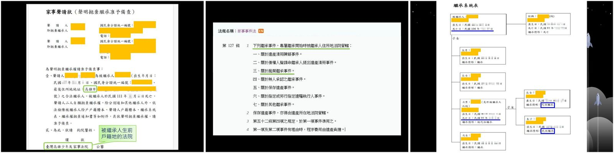
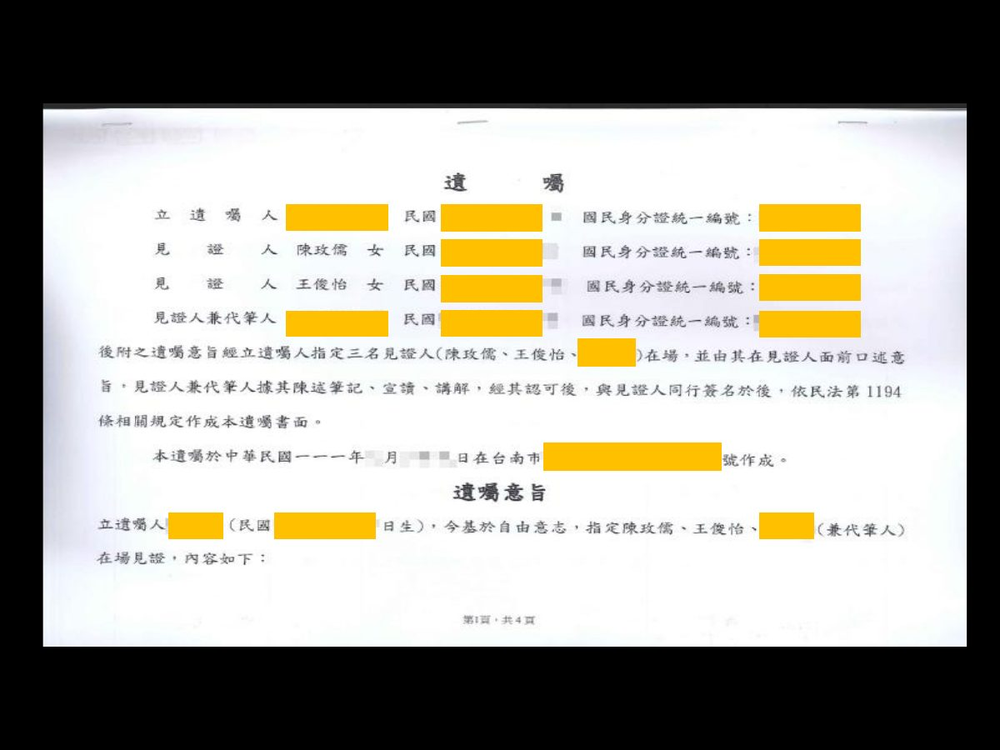
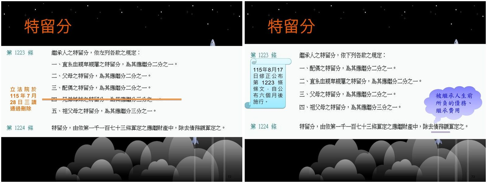

# 性別平權與生活法律（第六週）：繼承（三）與遺囑

> 王俊怡律師｜115.10.15
>
> 讀法：每段先讀「📘 重點內容」，再做「✏️ 練習題」，最後展開「解答」對答案。
> 「🖼️ 投影片圖示」是直接從 PDF 擷取的投影片圖片。
> 標示「📝 補充」的部分是投影片上沒有寫出、由整理者補上的說明。

---

## 暖身：複習上週（喪失繼承權、扣還、歸扣、遺產分割）

### ✏️ 練習題（是非題，答對加 2,000 分）

**Q1.** 繼承人對於被繼承人有重大侮辱情事，經被繼承人表示不得為繼承者，喪失繼承權。請問此敘述是否正確？

解答

**YES**（民法 §1145Ⅰ⑤，表示失權）

**Q2.** 繼承人湮滅被繼承人遺囑，但嗣後經其他繼承人發現並宥恕之，其繼承權不喪失。請問此敘述是否正確？

解答

**NO**

📝 說明：§1145Ⅱ 的宥恕必須由「**被繼承人**」為之，其他繼承人宥恕沒有用。

### ✏️ 練習題（債務之扣還）

**Q3.（答對加 2,000 分）**
甲中年喪妻，有子女丙、丁、戊三人。丙曾向甲借款 60 萬元，於甲死亡前尚未償還。甲死亡時，留下遺產 120 萬元。請問遺產分割時，丙可分得？

- A）0 元
- B）30 萬元
- C）40 萬元

解答

**A）0 元**

1. **先計算甲之應繼遺產**：120 萬元 + 60 萬元 = **180 萬元**。
2. **各繼承人應繼分價額**：丙、丁、戊共同繼承，應繼分各為 1/3，即 **60 萬元**。
3. **由應繼分價額扣除債務後所得之餘額**：60 萬元 − 60 萬元 = **0**。

📝 投影片解答寫成「乙、丙、丁共同繼承」，依題目應為丙、丁、戊。

**Q4.（舉手搶答，答對加 2,000 分）**
甲、乙為夫妻，有子女丙、丁。丙曾向甲借款 60 萬元，於甲死亡前尚未償還。甲死亡時，留下遺產 90 萬元。請問遺產分割時，原則上丙？

- A）可分得 30 萬元
- B）可分得 50 萬元
- C）不可再分得遺產，且須返還 10 萬元
- D）不可再分得遺產，且須返還 60 萬元

解答

**C）不可再分得遺產，且須返還 10 萬元**

1. **先計算甲之應繼遺產**：90 萬元 + 60 萬元 = **150 萬元**。
2. **各繼承人應繼分價額**：乙、丙、丁共同繼承，應繼分各為 1/3，即 **50 萬元**。
3. **由應繼分價額扣除債務後所得之餘額**：50 萬元 − 60 萬元 = **−10 萬元** → 應繼分 ＜ 債務，不得分配，且須返還差額。

### ✏️ 練習題（特種贈與之歸扣）

**Q5.（舉手搶答，答對加 2,000 分）**
下列事項均為被繼承人生前對繼承人所為之贈與，請問何者**不屬於**特種贈與歸扣之範圍？

- A）結婚宴客之費用
- B）因離鄉工作而在外購屋之頭期款
- C）經營小吃店之擺設
- D）出國留學費用

解答

**D）出國留學費用**

📝 說明：§1173 只列舉「結婚、分居、營業」三種；A 是結婚、B 是分居、C 是營業，留學不在其中。

**Q6.（舉手搶答，答對加 2,000 分）**
下列有關生前特種贈與歸扣的敘述，何者**錯誤**？

- A）生前特種贈與價額，以繼承開始時之價值計算。
- B）被繼承人於生前特種贈與時，有反對之意思表示者，受贈與之繼承人無須負歸扣之義務。
- C）我國民法關於應歸扣之贈與是列舉之規定。

解答

**A**

贈與價額依「**贈與時**」之價值計算（民法 §1173Ⅲ），不是繼承開始時。

**Q7.（綜合題）**
甲、乙為夫妻，有子女丙、丁、戊、己。嗣甲因病死亡，遺有財產 330 萬元。甲生前因乙營業贈與 30 萬元，因丙分居贈與 120 萬元，因丁結婚贈與 100 萬元，因戊出國留學贈與 80 萬元，己欠甲借款 20 萬元未還。請問乙、丙、丁、戊、己的實際繼承額？

- A）乙、丙、丁、戊、己實際繼承額各為 120 萬元
- B）乙、丙、丁、戊、己實際繼承額各為 136 萬元
- C）乙、丙、丁、戊、己實際繼承額依序為 90 萬元、0 元、20 萬元、120 萬元、100 萬元
- D）乙、丙、丁、戊、己實際繼承額依序為 106 萬元、16 萬元、36 萬元、56 萬元、116 萬元

解答

**C**

1. **先計算甲之應繼遺產**：330 萬元 + 30 萬元 + 120 萬元 + 100 萬元 + 20 萬元 = **600 萬元**。
   （戊的留學費用 80 萬元不是特種贈與，**不加回**。）
2. **各繼承人應繼分價額**（民法 §1144①、§1141）：乙、丙、丁、戊、己共同繼承，應繼分各為 1/5，即 **120 萬元**。
3. **實際可分得數額**：

| 繼承人 | 計算 | 實際繼承額 |
| --- | --- | --- |
| 乙 | 120 − 30（營業贈與） | **90 萬元** |
| 丙 | 120 − 120（分居贈與） | **0** |
| 丁 | 120 − 100（結婚贈與） | **20 萬元** |
| 戊 | 120（留學不歸扣） | **120 萬元** |
| 己 | 120 − 20（債務扣還） | **100 萬元** |

**Q8.（舉手搶答，答對加 2,000 分）**
下列何者**並非**遺產分割之方法？

- A）遺囑指定分割
- B）共同繼承人協議分割
- C）親屬會議決議分割
- D）訴請法院裁判分割

解答

**C）親屬會議決議分割**

---

## 一、繼承之態樣 —— 1. 概括繼承有限責任

### 📘 重點內容

> **民法第 1148 條**
> 1. 繼承人自繼承開始時，除本法另有規定外，承受被繼承人財產上之一切權利、義務。但權利、義務專屬於被繼承人本身者，不在此限。
> 2. 繼承人對於被繼承人之債務，**以因繼承所得遺產為限**，負清償責任。

> **民法第 1148 條之 1**
> 1. 繼承人在繼承開始前**二年內**，從被繼承人受有財產之贈與者，該財產**視為其所得遺產**。
> 2. 前項財產如已移轉或滅失，其價額，依贈與時之價值計算。

- **概括繼承**（民法 §1148Ⅰ）：權利、義務全部承受。
- **有限責任**（民法 §1148Ⅱ）：對被繼承人的債務，只以「所得遺產」為限負責。
- **所得遺產之範圍**（民法 §1148-1）：繼承開始前 2 年內受贈的財產也算進去。
- **§1148-1Ⅰ → 僅在規範繼承人對外債務清償責任的範圍。**
  - 例如：甲有 A、B 二子，甲對乙負有債務 600 萬元，甲本有 600 萬元之財產足以償還對乙之債務，但甲於死亡前二年內，將其價值 400 萬元之房屋贈與 A 並移轉所有權，導致甲死亡時其遺產僅剩 200 萬元。
  - 📝 這時 A 受贈的 400 萬元房屋視為 A 的所得遺產，A 不能用「遺產只剩 200 萬元」來逃避清償。

### ✏️ 練習題

**Q9.（舉牌回答，答對加 2,000 分）**
甲有子女乙、丙。甲生前曾贈與丙 100 萬元，1 年後甲死亡。乙、丙均未依法拋棄繼承。甲除生前對丁有 100 萬元債務，並無其他財產，則乙、丙對甲的債務應負的清償責任為何？

- A）僅乙負擔 100 萬元債務
- B）僅丙負擔 100 萬元債務
- C）乙、丙須連帶負擔 100 萬元債務
- D）乙、丙無須負擔 100 萬元債務

解答

**C）乙、丙須連帶負擔 100 萬元債務**

🖼️ 投影片圖示（左：本題；中、右：下一題）：

- 甲死亡前 1 年贈與丙 100 萬元 → 依 §1148-1Ⅰ **視為所得遺產**。
- 繼承人對於被繼承人之債務，以因繼承所得遺產為限，負**連帶**責任（民法 §1153Ⅰ）。

**Q10.（舉牌回答，答對加 2,000 分）**
甲死亡時，留有財產 80 萬元，另欠丁銀行 120 萬元債務尚未清償。甲之繼承人為子乙、丙。甲死亡前一年，曾贈與乙 20 萬元。乙、丙均未依法拋棄繼承。若丁向乙請求清償債務全額，乙提出有限責任的抗辯，則乙應清償的金額？

- A）40 萬元
- B）60 萬元
- C）80 萬元
- D）100 萬元

解答

**D）100 萬元**

📝 說明：所得遺產 = 遺產 80 萬元 + 視為所得遺產的受贈 20 萬元 = 100 萬元。乙以此為限負連帶責任，所以債權人向乙請求時，乙最多清償 100 萬元。

**Q11.（舉牌回答，答對加 2,000 分）**
繼承人在繼承開始前幾年內，從被繼承人受有財產之贈與者，該財產視為其所得遺產？

- A）一年
- B）二年
- C）五年
- D）十年

解答

**B）二年**（民法 §1148-1Ⅰ）

---

## 二、繼承之態樣 —— 2. 繼承人提出遺產清冊

### 📘 重點內容

- **開具遺產清冊陳報法院**（民法 §1156）：繼承人於知悉其得繼承之時起 **3 個月內** 開具遺產清冊陳報法院。
- **報明債權的公示催告**（民法 §1157、家事事件法 §130Ⅴ）
  - 期間：**六個月以上**
  - 對象：被繼承人之債權人
  - 此期間內**不得**清償（民法 §1158）
- **清償債務、交付遺贈之順序**（民法 §1159、§1160）
  1. 有優先權之債權
  2. 普通債權
  3. 交付遺贈
  4. 未報明且為繼承人所不知之債權（民法 §1162）

🖼️ 投影片圖示（陳報遺產清冊的家事聲請狀與法院裁定）：

---

## 三、繼承之態樣 —— 3. 概括繼承無限責任

### 📘 重點內容

> **民法第 1163 條**（法定無限責任的情形）
> 繼承人中有下列各款情事之一者，**不得主張第一千一百四十八條第二項所定之利益**：
> 一、**隱匿遺產**情節重大。
> 二、**在遺產清冊為虛偽之記載**情節重大。
> 三、**意圖詐害被繼承人之債權人之權利而為遺產之處分**。

📝 說明：有上述情形，就不能主張「以所得遺產為限」的有限責任，要用自己的財產負無限責任。

---

## 四、繼承之態樣 —— 4. 拋棄繼承

### 📘 重點內容

> **民法第 1174 條**
> 1. 繼承人得拋棄其繼承權。
> 2. 前項拋棄，應於知悉其得繼承之時起**三個月內**，**以書面向法院為之**。（← **效力規定**）
> 3. 拋棄繼承後，應以書面通知因其拋棄而應為繼承之人。但不能通知者，不在此限。（← **非效力規定**）

> **民法第 1175 條** 繼承之拋棄，溯及於繼承開始時發生效力。

**要件**

- 繼承開始「**後**」為之。
- 須**繼承人**始得為之。
- 知悉得繼承之時起 **3 個月內** 為之。
- **書面向法院**為之 → 被繼承人**生前戶籍地**的法院（家事事件法 §127Ⅰ③：專屬繼承開始時被繼承人住所地法院管轄）。

🖼️ 投影片圖示（左起：聲明拋棄繼承的家事聲請狀、家事事件法 §127、繼承系統表）：

**實務見解**

> 「繼承權之拋棄，係指繼承開始後，繼承人依法定方式於法定期間內否認自己開始繼承效力之意思表示。從而，**繼承開始前預為繼承權之拋棄、法定期間過後所為繼承權之拋棄，暨非書面之拋棄繼承意思表示，均不能認為有效**。」（最高法院 89 年度台上字第 595 號民事判決）

> 「繼承之拋棄，係就被繼承人**全部遺產**，為拋棄繼承權之表示，**不得專就被繼承人之某一特定債權為繼承之拋棄**。」（最高法院 67 年度台上字第 3788 號民事判決）

### ✏️ 練習題

**Q12.（舉牌回答，答對加 2,000 分）**
繼承人拋棄其繼承權應以書面向何者為意思表示，始生效力？

- A）被繼承人之債權人
- B）其他繼承人
- C）親屬會議
- D）法院

解答

**D）法院**（民法 §1174Ⅱ）

**Q13.（舉牌回答，答對加 2,000 分）**
關於拋棄繼承，下列敘述何者正確？

- A）得於繼承開始前為之
- B）得為一部拋棄
- C）不得附條件或期限

解答

**C）不得附條件或期限**

- A 錯：繼承開始前預為拋棄無效（最高法院 89 年度台上字第 595 號）。
- B 錯：須就全部遺產拋棄，不得一部拋棄（最高法院 67 年度台上字第 3788 號）。

---

## 五、遺囑 —— 1. 通則

### 📘 重點內容

**意義**

- 依法定方式為之
- 無相對人之單獨行為
- 於遺囑人死後發生效力（民法 §1199：遺囑自遺囑人**死亡時**發生效力）

**特殊性**

- **要式性**（民法 §1189）→ 確保遺囑人之真意
- **可變動性**
- **一身專屬性**

**遺囑能力**

> **民法第 1186 條**
> 1. 無行為能力人，不得為遺囑。
> 2. 限制行為能力人，無須經其法定代理人之允許，得為遺囑。但未滿十六歲者，不得為遺囑。

- 有遺囑能力：**滿 16 歲且未受監護宣告之人**
- 沒有遺囑能力：① 未滿 16 歲的人 ② 受監護宣告之人
  - 📝 投影片的對話框寫「未滿七歲之未成年人、受監護宣告之人」是「無行為能力人」的範圍；再加上 §1186Ⅱ 但書，未滿 16 歲都不能立遺囑。
- Q：受監護人縱然回復常態？→ 📝 只要監護宣告還沒撤銷，仍是無行為能力人，所立遺囑無效。
- 決定遺囑能力的時期：**作成遺囑時**

### ✏️ 練習題

**Q14.（舉牌回答，答對加 2,000 分）**
依民法規定，得為遺囑之年齡是幾歲？

- A）20 歲
- B）18 歲
- C）16 歲

解答

**C）16 歲**（民法 §1186Ⅱ）

**Q15.（舉牌回答，答對加 2,000 分）**
30 歲的甲受監護宣告後，所為之遺囑，其效力為何？

- A）有效
- B）得撤銷
- C）無效

解答

**C）無效**（受監護宣告之人為無行為能力人，§1186Ⅰ）

**Q16.（舉牌回答，答對加 2,000 分）**
甲 17 歲，現為大一新鮮人。甲未得法定代理人之允許，自書遺囑一份，載明將所有財產留給學校作為獎學金。請問該遺囑之效力為何？

- A）無效，因為內容違反特留分
- B）無效，因未得法定代理人事前允許
- C）效力未定，須經法定代理人事後承認
- D）有效，無須法定代理人之允許

解答

**D）有效，無須法定代理人之允許**（民法 §1186Ⅱ）

📝 說明：遺囑違反特留分並不會無效，只是特留分被侵害的人可以行使扣減權（§1225）。

**Q17.（舉牌回答，答對加 2,000 分）**
依民法規定，遺囑的生效時點？

- A）遺囑人作成遺囑時
- B）遺囑人死亡時
- C）法院認可遺囑時

解答

**B）遺囑人死亡時**

遺囑自遺囑人死亡時發生效力。（民法 §1199）

---

## 六、遺囑 —— 2. 遺囑之方式

### 📘 重點內容：五種遺囑方式（民法 §1189）

| 方式 | 條文 | 見證人 | 重點 |
| --- | --- | --- | --- |
| 自書遺囑 | §1190 | **不需要** | 自書全文、記明年月日、親自簽名 |
| 公證遺囑 | §1191 | **2 人以上** | 在公證人前口述 |
| 密封遺囑 | §1192 | **2 人以上** | 簽名、密封、向公證人提出 |
| 代筆遺囑 | §1194 | **3 人以上** | 由見證人之一筆記 |
| 口授遺囑 | §1195 | **2 人以上** | 生命危急等特殊情形才能用 |

### 📘 重點內容：自書遺囑（民法 §1190）

- **自書遺囑全文**。Q：電腦打字？ → **NO**
- **記明年、月、日**。
- **親自簽名**。Q：簽別名、筆名、藝名？ → **可得確定即可**。

### 📘 重點內容：公證遺囑（民法 §1191）

- 指定**二人以上**之見證人。
- 在公證人前**口述**遺囑意旨。Q：點頭、手勢？ → **NO**
- 公證人筆記、宣讀、講解，經遺囑人認可。
- 記明年、月、日，由公證人、見證人及遺囑人同行簽名。

### 📘 重點內容：密封遺囑（民法 §1192）

- 遺囑人於遺囑上簽名。
- 遺囑人將遺囑密封，於封縫處簽名。
- 遺囑人指定**二人以上**之見證人，向公證人提出，陳述其為自己之遺囑，如非遺囑人自寫，並陳述繕寫人之姓名、住所。
- 公證人於遺囑封面記明該遺囑提出之年、月、日及遺囑人所為之陳述。
- 公證人、遺囑人及見證人同行簽名。
- 📝 **無效密封遺囑之轉換**（民法 §1193）：密封遺囑不具備上述方式，而具備自書遺囑之方式者，有自書遺囑之效力。

### 📘 重點內容：代筆遺囑（民法 §1194）

- 遺囑人指定**三人以上**之見證人。
- 遺囑人**口述**遺囑意旨。
- **見證人中之一人**筆記、宣讀、講解。Q：打字？ → **可以**
  > 法務部法律字第 10803501680 號函示：「民法代筆遺囑規定重在透過代筆見證人將遺囑人之遺囑意旨以文字予以表明，至公證遺囑所重者應為公證人對於遺囑法律關係專業，從而民法有關公證遺囑及代筆遺囑規定中所稱『筆記』，解釋上**均可以電腦打字**或自動化機器製作。」
- 經遺囑人認可後，記明年、月、日及代筆人之姓名。
- 由見證人全體及遺囑人同行簽名，遺囑人不能簽名者，應**按指印**代之。Q：以印章代之？ → **NO**

🖼️ 投影片圖示（代筆遺囑範例）：

### 📘 重點內容：口授遺囑（民法 §1195～§1197）

- **前提要件**
  - 生命危急或其他特殊情形
  - 不能依其他方式為遺囑
- **方式**
  - 筆記口授遺囑
  - 錄音口授遺囑
- **失效**（民法 §1196）：自遺囑人能依其他方式為遺囑之時起，經過 **三個月** 而失其效力。
- **認定**（民法 §1197）：應由見證人中之一人或利害關係人，於為遺囑人死亡後三個月內，提經親屬會議認定其真偽。

### ✏️ 練習題

**Q18.（舉牌回答，答對加 2,000 分）**
甲在醫院自書遺囑，但不及簽名即死亡，繼承人遂以甲的印章蓋之。請問該遺囑之效力為何？

- A）有效
- B）得撤銷
- C）無效

解答

**C）無效**

📝 說明：自書遺囑必須「親自簽名」，不能用蓋章代替，更何況是別人在遺囑人死後才蓋的。

**Q19.（舉牌回答，答對加 2,000 分）**
遺囑方式中，何種**不需要**遺囑見證人？

- A）密封遺囑
- B）口授遺囑
- C）公證遺囑
- D）自書遺囑

解答

**D）自書遺囑**

**Q20.（舉牌回答，答對加 2,000 分）**
遺囑方式中，何種**不需要**遺囑人本人簽名或按指印？

- A）密封遺囑
- B）口授遺囑
- C）公證遺囑
- D）代筆遺囑

解答

**B）口授遺囑**

📝 說明：口授遺囑由見證人筆記或錄音，由見證人簽名，遺囑人本人不用簽名。

**Q21.（舉牌回答，答對加 2,000 分）**
公證遺囑，應指定至少幾人以上之見證人？

- A）1 人
- B）2 人
- C）3 人

解答

**B）2 人**（民法 §1191）

**Q22.（舉牌回答，答對加 2,000 分）**
關於代筆遺囑，代筆人須為見證人中之一人？

解答

**Yes**（民法 §1194：由見證人中之一人筆記、宣讀、講解）

### 📘 重點內容：立遺囑的步驟

1. 列出遺囑人的財產
2. 決定財產如何分配
3. 決定遺囑執行人
4. 撰寫遺囑（須符合民法之規定）
5. 將遺囑存放於適當位置

---

## 七、遺囑 —— 5. 特留分

### 📘 重點內容：特留分的意義

- 為保護法定繼承人而對被繼承人之遺囑自由加以限制的制度。
- **有繼承權之人始享有**。→ 喪失繼承權人、拋棄繼承人**無**特留分權。

### 📘 重點內容：特留分之比例（民法 §1223）與修法

> **民法第 1224 條** 特留分，由依第一千一百七十三條算定之應繼財產中，**除去債務額**算定之。

🖼️ 投影片圖示（左：修法前 §1223，兄弟姊妹之特留分經立法院於 115 年 7 月 28 日三讀通過刪除；右：115 年 8 月 17 日修正公布的新 §1223）：

- 立法院於 **115 年 7 月 28 日** 三讀通過**刪除兄弟姊妹之特留分**。
- **115 年 8 月 17 日** 修正公布第 1223 條條文，自公布 **六個月後** 施行。

| 繼承人 | 特留分 |
| --- | --- |
| 直系血親卑親屬 | 應繼分的 **1/2** |
| 父母 | 應繼分的 **1/2** |
| 配偶 | 應繼分的 **1/2** |
| ~~兄弟姊妹~~ | ~~應繼分的 1/3~~ → **刪除** |
| 祖父母 | 應繼分的 **1/3** |

- 計算特留分時要先扣除：**被繼承人生前所負的債務、繼承費用**（§1224）。
- 📝 **遺贈不能先扣**：遺贈正是特留分要對抗的對象。

### ✏️ 練習題

**Q23.（舉牌回答，答對加 2,000 分）**
父母的特留分，為其應繼分之多少？

- A）三分之二
- B）二分之一
- C）三分之一
- D）四分之一

解答

**B）二分之一**

**Q24.（舉牌回答，答對加 2,000 分）**
祖父母的特留分，為其應繼分之多少？

- A）三分之二
- B）二分之一
- C）三分之一
- D）四分之一

解答

**C）三分之一**

**Q25.（舉牌回答，答對加 2,000 分）**
甲死亡時，留下遺產 480 萬元。甲的繼承人有配偶乙、兄丙、妹丁。若甲以遺囑贈與男友戊 180 萬元，甲的配偶乙之特留分額為何？

- A）80 萬元
- B）100 萬元
- C）120 萬元
- D）160 萬元

解答

**C）120 萬元**

📝 計算：

1. 配偶與第三順位（兄弟姊妹）共同繼承 → 乙的應繼分 **1/2**（§1144②）。
2. 乙的應繼分價額：480 萬元 × 1/2 = 240 萬元（遺贈不扣）。
3. 配偶特留分為應繼分的 1/2：240 萬元 × 1/2 = **120 萬元**。

**Q26.（舉牌回答，答對加 2,000 分）**
甲中年喪偶，有子女乙、丙二人，甲對丁負有債務 20 萬元，甲立有遺囑遺贈戊 20 萬元。甲死亡時留有財產 100 萬元，其喪葬費用 40 萬元，則丙之特留分為？

- A）5 萬元
- B）10 萬元
- C）15 萬元
- D）20 萬元

解答

**B）10 萬元**

📝 計算：

1. 計算特留分的基礎：100 萬元 − 債務 20 萬元 − 喪葬費用 40 萬元 = **40 萬元**（遺贈 20 萬元**不扣**）。
2. 乙、丙應繼分各 1/2 → 丙的應繼分價額 20 萬元。
3. 直系血親卑親屬特留分為應繼分的 1/2 → 20 萬元 × 1/2 = **10 萬元**。

---

## 八、遺囑 —— 6. 扣減權

### 📘 重點內容

> **民法第 1225 條** 應得特留分之人，如因被繼承人所為之**遺贈**，致其應得之數不足者，得按其不足之數由遺贈財產扣減之。受遺贈人有數人時，應按其所得遺贈價額**比例**扣減。

**實務見解**

> 「應得特留分之人，如因被繼承人之**遺囑指定遺產分割方法**，依遺囑內容實施結果，致其應得之額不足特留分時，特留分被侵害之繼承人，得**類推適用民法第 1225 條**規定，行使特留分扣減權，該扣減權性質上屬**物權之形成權**，民法就此雖未設有規定，惟特留分權利人行使扣減權，與正當繼承人行使繼承回復請求權之法律效果相類似，可類推適用民法第 1146 條第 2 項規定，以**知悉特留分權被侵害時起**，起算行使扣減權之 **2 年除斥期間**。」（最高法院 113 年度台上字第 1403 號民事判決）

---

## 📋 速記總整理

| 主題 | 一句話記住 |
| --- | --- |
| 宥恕 | 只有**被繼承人**能宥恕，且只限 §1145Ⅰ②③④ |
| 扣還 | 債務加回 → 算應繼分 → 扣掉債務；不夠扣要返還差額 |
| 歸扣 | 只有結婚、分居、營業；留學、生日禮物不算；依**贈與時**價值 |
| 分割方法 | 遺囑指定、協議、裁判；**沒有**親屬會議決議 |
| 有限責任 | 以所得遺產為限（§1148Ⅱ）；繼承前 **2 年內** 受贈視為所得遺產（§1148-1）；繼承人間負連帶責任 |
| 遺產清冊 | 3 個月內陳報；公示催告 6 個月以上，期間內不得清償 |
| 清償順序 | 優先權債權 → 普通債權 → 遺贈 → 未報明且不知之債權 |
| 無限責任 | 隱匿遺產、清冊虛偽記載、詐害債權人處分遺產（§1163） |
| 拋棄繼承 | 繼承開始後、知悉起 3 個月內、書面向法院；不得一部拋棄、不得附條件期限 |
| 遺囑能力 | 滿 16 歲且未受監護宣告；不用法定代理人同意；以作成時判斷 |
| 遺囑生效 | 遺囑人死亡時（§1199） |
| 見證人人數 | 自書 0、公證 2、密封 2、代筆 3、口授 2 |
| 簽名 | 自書要親簽（不能蓋章）；代筆不能簽要按指印（不能蓋章）；口授本人不用簽 |
| 特留分 | 子女、父母、配偶 1/2；祖父母 1/3；兄弟姊妹特留分已刪除（115.8.17 公布，6 個月後施行） |
| 特留分基礎 | 應繼財產扣債務、繼承費用；**不扣遺贈** |
| 扣減權 | 從遺贈按比例扣減（§1225）；遺囑指定分割方法也可類推；知悉起 2 年 |
