# 第2週（114/09/16）民法：法律行為與行為能力 — 自修講義

> 來源：`第2週-1140916 (1).pdf`
> 社團法人台南市職能治療師公會 15 周年慶祝活動暨公益講座
> 授課老師：陳玫儒

使用方式：每一段先讀「內容」，再做「題目」，最後點開「解答」對答案。

「🖼️ 投影片圖示」是直接從 PDF 擷取的投影片圖片；標示「📝 補充」的部分是投影片上沒有寫出、由整理者補上的說明。

---

## 第 0 部分：課堂分組與暖身活動

全班分為九組：第一組、第二組、第三組、第四組、第五組、第六組、第七組、第八組、第九組。

### 暖身：有關我的一天 —「兩真一假」

老師示範：

> 我今天 34 歲 又 5 個月 6 天
> 關於我的一天（說出三件事，其中兩件是真的、一件是假的）

接著：**選出某小組成員** → 「OOO 的一天，兩真一假」，由全班猜哪一件是假的。

---

## 第 1 部分：從「我的一天」看法律行為

### 1-1 內容

**例一：把筆電丟掉**

| | |
|---|---|
| 外觀 | 把筆電丟掉的行為 |
| 內心 | 企圖發生「拋棄」筆電所有權的法律效力 |
| 結果 | 產生「拋棄」筆電所有權的法律效力 |

**例二：在 7-11 買御飯糰**

| | |
|---|---|
| 外觀 | 在 7-11 付錢，拿走了御飯糰 |
| 內心 | 企圖發生「買賣」的法律效力 |
| 結果 | 產生「買賣」的法律效力 |

🖼️ 投影片圖示（左：拋棄筆電；右：買御飯糰）：

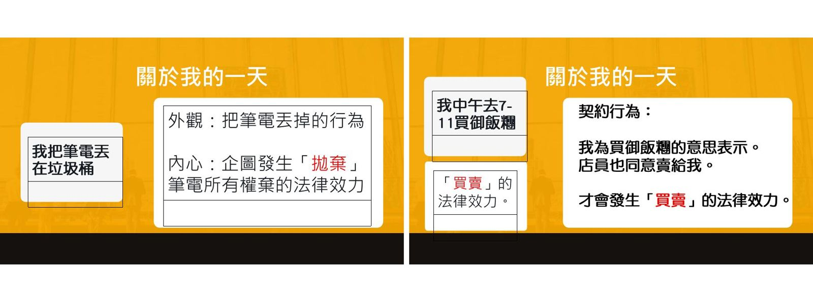

### 1-2 內容：法律行為是什麼？

**法律行為**：行為人為「意思表示」，這個行為符合法律的某規定，產生一定的法律效果，因而行為人必須遵循該法律規範。

（外觀上的行為 + 內心想發生法律效果的意思 ＝ 意思表示 → 產生法律效果）

### 1-3 內容：法律行為的類型

1. **單獨行為**：只需一方的意思表示就能成立（例：拋棄筆電所有權）。
2. **契約行為**：需要雙方意思表示一致才能成立（例：在 7-11 買御飯糰＝買賣契約）。

🖼️ 投影片圖示：

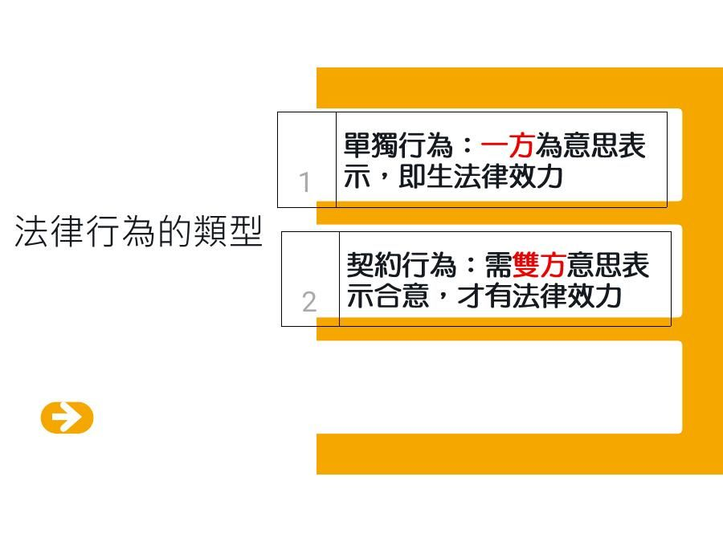

### 1-3 題目

**Q1.** 分析組員「我的一天」中的行為，分別屬於下列哪一種？
（A）單獨行為　（B）契約行為

試判斷：
- (1) 把筆電丟掉
- (2) 在 7-11 付錢買御飯糰

<details>
<summary>解答</summary>

- (1) 把筆電丟掉 → **單獨行為**（拋棄所有權，只要自己一方的意思表示即可）
- (2) 在 7-11 買御飯糰 → **契約行為**（買賣，需要買方與店家雙方意思表示一致）

</details>

---

## 第 2 部分：民法的行為能力

### 2-1 內容

思考：**會因為年齡、精神狀態的不同，影響法律行為是否有效嗎？** → 會，這就是「行為能力」。

**行為能力**：能獨立以自己的意思，使自己的行為在法律上產生效果的資格。

行為能力分三種：

| 類型 | 法律行為效力 |
|---|---|
| 無行為能力 | 無效 |
| 限制行為能力 | 視情況（下面詳述） |
| 完全行為能力 | 有效 |

🖼️ 投影片圖示：

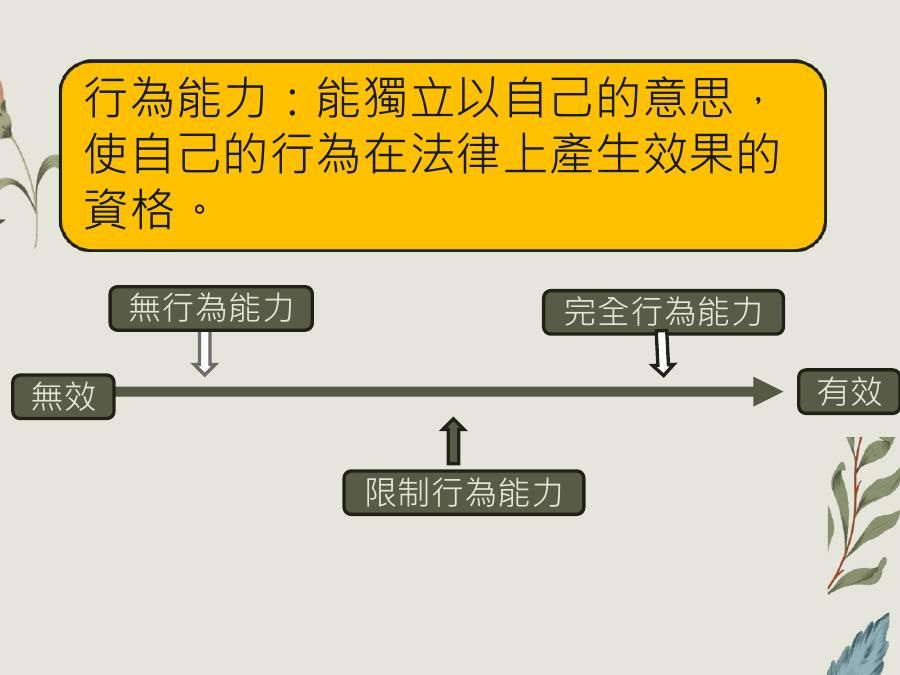

### 2-1 題目

**Q2.** 請問「民法」規定的成年，是幾歲？
（A）16 歲　（B）18 歲　（C）20 歲

<details>
<summary>解答</summary>

**（B）18 歲**

> **民法第 12 條**　滿十八歲為成年。

</details>

**Q3.** 請問「刑法」規定的成年，是幾歲？
（A）16 歲　（B）18 歲　（C）20 歲

<details>
<summary>解答</summary>

**（B）18 歲**（滿 18 歲才負完全刑事責任）

> **刑法第 18 條**
> 未滿十四歲人之行為，不罰。
> 十四歲以上未滿十八歲人之行為，得減輕其刑。
> 滿八十歲人之行為，得減輕其刑。

</details>

---

## 第 3 部分：無行為能力人（未滿 7 歲）— 買東西

### 3-1 法條內容

> **民法第 13 條**　未滿七歲之未成年人，無行為能力。滿七歲以上之未成年人，有限制行為能力。
>
> **民法第 75 條**　無行為能力人之意思表示，無效；
>
> **民法第 76 條**　無行為能力人由法定代理人代為意思表示，並代受意思表示。

年齡分界：

```
0 歲 ──── 7 歲 ──────────── 18 歲 ────→
 無行為能力 │   限制行為能力    │ 完全行為能力
  （無效）  │                  │  （有效）
```

### 3-1 題目

**Q4.** 4 歲的小朋友，事先沒有經過法定代理人同意，自己去 7-11 買冰淇淋，是有效之法律行為嗎？

<details>
<summary>解答</summary>

**不是，無效。**

- 行為類型：買冰淇淋 → 契約行為（買賣）
- 4 歲 → 未滿 7 歲 → **無行為能力人**（民法第 13 條）
- 無行為能力人之意思表示，無效（民法第 75 條）
- 要買東西，應由法定代理人代為意思表示（民法第 76 條）

</details>

---

## 第 4 部分：限制行為能力人（7 歲～未滿 18 歲）— 例外有效

### 4-1 法條內容

> **民法第 77 條**　限制行為能力人為意思表示及受意思表示，應得法定代理人之允許。但純獲法律上利益，或依其年齡及身分、日常生活所必需者，不在此限。

限制行為能力人不需法定代理人允許、法律行為仍有效的兩種例外：
1. **日常生活所必需**
2. **純獲法律上利益**

🖼️ 投影片圖示：

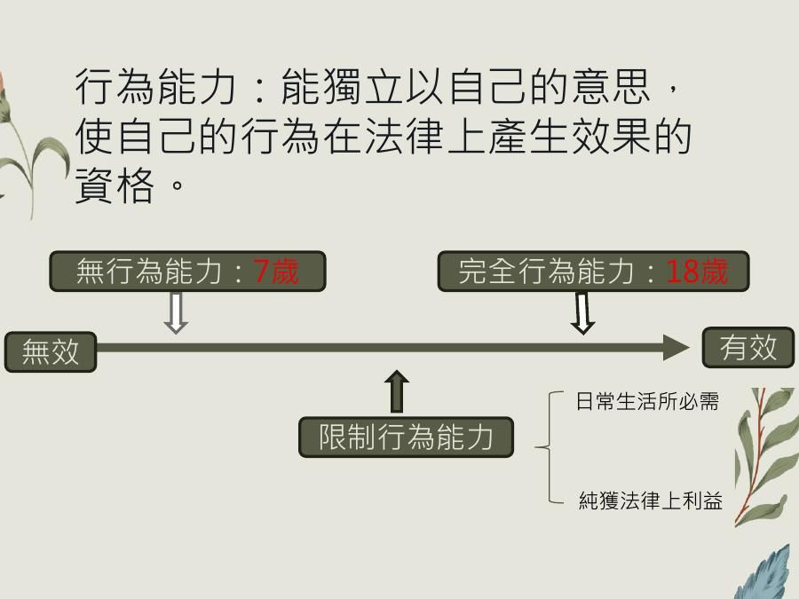

### 4-1 題目

**Q5.** 12 歲的小朋友，事先沒有經過法定代理人同意，自己去 7-11 買冰淇淋，是有效之法律行為嗎？

<details>
<summary>解答</summary>

**是，有效。**

- 12 歲 → 滿 7 歲未滿 18 歲 → **限制行為能力人**（民法第 13 條）
- 原則上要法定代理人允許，但買冰淇淋屬於「依其年齡及身分、**日常生活所必需**」→ 不需允許，有效（民法第 77 條但書）

</details>

---

## 第 5 部分：限制行為能力人的契約 — 效力未定

### 5-1 法條內容

> **民法第 79 條**　限制行為能力人未得法定代理人之允許，所訂立之契約，須經法定代理人之承認，始生效力。

限制行為能力人的契約要有效，可以透過：
- **法定代理人事先允許**（第 77 條）
- **法定代理人事後承認**（第 79 條）
- 或屬於「日常生活所必需」「純獲法律上利益」（第 77 條但書）

🖼️ 投影片圖示（完整版行為能力圖）：

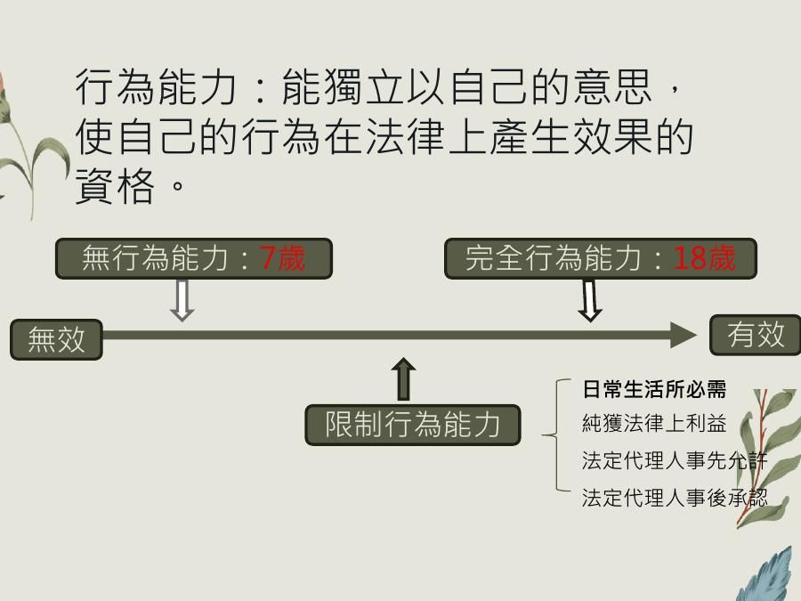

### 5-1 題目

**Q6.** 12 歲的小朋友，事先沒有經過法定代理人的同意，可以自己向遊戲公司購買 10 萬元的遊戲點數？（亦即有效之法律行為）

<details>
<summary>解答</summary>

**不能直接有效 → 效力未定。**

- 行為類型：買遊戲點數 → 契約行為（買賣）
- 12 歲 → 限制行為能力人（民法第 13 條）
- 10 萬元遊戲點數不是日常生活所必需，也不是純獲法律上利益（要付錢）→ 不適用第 77 條但書
- 事前未得允許 → 須經法定代理人**事後承認**才生效力（民法第 79 條）

</details>

### 5-2 法條內容：相對人的催告權

> **民法第 80 條**
> 前條契約相對人，得定一個月以上之期限，催告法定代理人，確答是否承認。
> 於前項期限內，法定代理人不為確答者，視為拒絕承認。

### 5-2 題目（實作）

**Q7.** 12 歲的小朋友到你經營的遊戲公司購買 10 萬元的遊戲點數，而且你已經把遊戲點數給小朋友了，小朋友也付錢了，身為遊戲公司老闆，你會怎麼做？

**Q8.** 請寫一封存證信函給小朋友的法定代理人，請他確認是否承認小朋友購買的點數。

<details>
<summary>解答</summary>

**Q7**：契約效力未定（民法第 79 條），老闆可以依民法第 80 條，定一個月以上的期限，**催告法定代理人確答是否承認**。期限內不回覆 → 視為拒絕承認。

**Q8 存證信函範例：**

> **主旨**：請 台端於文到後 31 日確認王小明於 114 年 3 月 21 日於我司（即 XX 遊戲點數公司）購買之點數 10 萬元，是否同意？
>
> **說明**：
> 一、經查，王小明於 114 年 3 月 21 日於我司購買遊戲點數 10 萬元，我方發現其為未成年，故依民法第 79 條規定，未經法定代理人允許之契約行為，效力未定。
> 二、是我司依民法第 80 條規定，向 台端催告確認是否承認王小明於上開期間向我司購買之遊戲點數。並請 台端於文到後 31 日通知我司，以利確認雙方法律關係。

（注意：期限要「一個月以上」，所以寫 31 日。）

</details>

---

## 第 6 部分：接受贈與不動產

### 6-1 題目（無行為能力人）

**Q9.** 4 歲的小朋友，事前沒有經過法定代理人的同意，可以自行接受他人贈與不動產？（亦即有效之法律行為）

<details>
<summary>解答</summary>

**不可以，無效。**

- 行為類型：贈與／受贈 → 契約行為（贈與）
- 4 歲 → 無行為能力人（民法第 13 條）
- 無行為能力人之意思表示，無效（民法第 75 條）——即使是純獲利益也一樣無效
- 應由法定代理人代為、代受意思表示（民法第 76 條）

</details>

### 6-2 題目（限制行為能力人）

**Q10.** 12 歲的小朋友，事前沒有經過法定代理人的同意，可以自行接受他人贈與不動產？（亦即有效之法律行為）

<details>
<summary>解答</summary>

**可以，有效。**

- 12 歲 → 限制行為能力人（民法第 13 條）
- 單純接受贈與，自己不用負擔任何義務 → **純獲法律上利益** → 不需法定代理人允許（民法第 77 條但書）

</details>

### 6-3 題目（附條件的贈與）

**Q11.** 16 歲的未成年人，事前沒有經過法定代理人的同意，若他人表示「幫忙跑腿買東西，就贈與不動產」？（亦即有效之法律行為）

<details>
<summary>解答</summary>

**不能直接有效 → 效力未定。**

- 行為類型：贈與／受贈 → 契約行為（贈與）
- 16 歲 → 限制行為能力人（民法第 13 條）
- 要「幫忙跑腿」才能得到不動產 → 自己要付出義務，**不是純獲法律上利益**，也不是日常生活所必需 → 不適用第 77 條但書
- 未得允許之契約 → 須經法定代理人承認，始生效力（民法第 79 條）

</details>

---

## 第 7 部分：限制行為能力人的單獨行為

### 7-1 法條內容

> **民法第 78 條**　限制行為能力人未得法定代理人之允許，所為之單獨行為，無效。

### 7-1 題目

**Q12.** 16 歲未成年人，事前沒有經過法定代理人的同意，可以任意拋棄 PS5？（亦即有效之法律行為）

<details>
<summary>解答</summary>

**不可以，無效。**

- 行為類型：拋棄 → **單獨行為**
- 16 歲 → 限制行為能力人（民法第 13 條）
- 未得法定代理人允許之單獨行為，**無效**（民法第 78 條）
- 注意：單獨行為是「無效」，契約行為是「效力未定」，兩者不同！

</details>

---

## 第 8 部分：總結 — 行為能力（自我測驗版）

### 8-1 題目

**Q13.** 請回答以下各項：

**7 歲以下**
- (1) 自己所為的意思表示，效力如何？
- (2) 若要為有效的法律行為，應如何處理？

**7 歲以上 18 歲以下**
- 原則：
  - (3) 單獨行為：事前經法定代理人同意，效力如何？
  - (4) 單獨行為：事前未獲得法定代理人允許，效力如何？
  - (5) 契約行為：事前經法定代理人同意，效力如何？
  - (6) 契約行為：事前未獲得法定代理人允許，效力如何？
- 特殊情形：
  - (7) 哪兩種情形，不須經過法定代理人同意，法律行為有效？

<details>
<summary>解答</summary>

**7 歲以下（無行為能力人，民法第 13 條第 1 項）**
- (1) 自己所為之意思表示：**無效**（民法第 75 條）
- (2) 應由法定代理人或監護人**代為、代受**意思表示（民法第 76 條）

**7 歲以上 18 歲以下（限制行為能力人，民法第 13 條第 2 項）**
- 原則：
  - (3) 單獨行為，事前經法定代理人同意：**有效**（民法第 77 條）
  - (4) 單獨行為，事前未獲得法定代理人允許：**無效**（民法第 78 條）
  - (5) 契約行為，事前經法定代理人同意：**有效**（民法第 77 條）
  - (6) 契約行為，事前未獲得法定代理人允許：**效力未定**（民法第 79 條）
- 特殊情形：
  - (7) **日常生活所必需**、**純獲法律上之利益**（民法第 77 條但書）

</details>

---

## 第 9 部分：未成年人有無敵星星嗎？— 詐術條款

### 9-1 內容：新聞案例

> 華視新聞（主播 朱培滋）：**屏東卡被盜刷 30 萬？竟是 10 歲兒買遊戲點數**

🖼️ 投影片圖示：

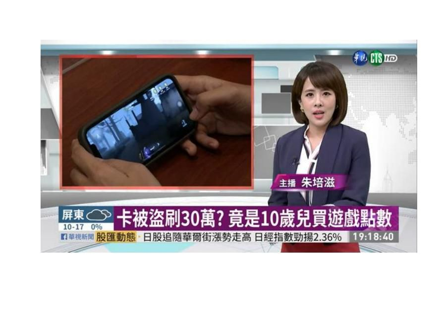

網路遊戲公司網站公告「未成年人購買應經法定代理人同意」。

### 9-1 題目

**Q14.** 15 歲小明於網路上點選「法定代理人同意」，並購買 10 萬元的點數，爸媽知道後可以請求網路遊戲公司退費嗎？

先想想相關法條：

> **民法第 77 條**　限制行為能力人為意思表示及受意思表示，應得法定代理人之允許。但純獲法律上利益，或依其年齡及身分、日常生活所必需者，不在此限。
>
> **民法第 79 條**　限制行為能力人未得法定代理人之允許，所訂立之契約，須經法定代理人之承認，始生效力。

<details>
<summary>解答</summary>

**原則上不行，買賣契約有效。**

- 行為類型：買遊戲點數 → 契約行為（買賣）
- 15 歲 → 限制行為能力人；本來依第 79 條效力未定
- 但小明自己點選「法定代理人同意」，等於**用詐術使人相信已得法定代理人允許** → 依民法第 83 條，法律行為**有效**
- 理由：未成年人受保護是因為心智尚未成熟；既然能使用詐術騙過對方，表示心智成熟度已超過實際年齡，不需再特別保護。

> **民法第 83 條**　限制行為能力人用詐術使人信其為有行為能力人或已得法定代理人之允許者，其法律行為為有效。

</details>

### 9-2 內容：實際判決（臺灣臺北地方法院 111 年度北小字第 1752 號）

- 【裁判字號】111，北小，1752
- 【裁判日期】民國 111 年 10 月 14 日
- 【裁判案由】返還不當得利
- 【裁判內文】臺灣臺北地方法院民事判決　111 年度北小字第 1752 號

🖼️ 投影片圖示（判決首頁，主文「原告之訴駁回」）：

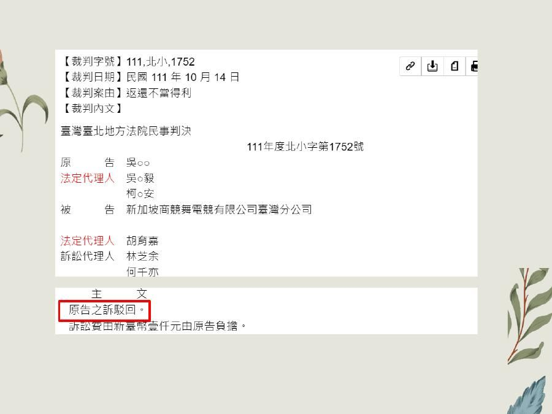

| 當事人 | |
|---|---|
| 原告 | 吳○○ |
| 法定代理人 | 吳○毅、柯○安 |
| 被告 | 新加坡商競舞電競有限公司臺灣分公司 |
| 法定代理人 | 胡育嘉 |
| 訴訟代理人 | 林芝余、何千亦 |

**主文**
- 原告之訴駁回。
- 訴訟費用新臺幣壹仟元由原告負擔。

**判決理由節錄（一）**

> 2、次按限制行為能力人未得法定代理人之允許，所訂立之契約，須經法定代理人之承認，始生效力。民法第 79 條定有明文。而上開規定係為保障限制行為能力人所為之規範，且在面對交易安全與限制行為能力人之保障有所衝突時，立法者明文揭示原則以後者為優先，除非有例外規定之情形（如民法第 83 條）。又限制行為能力人用詐術使人信其為有行為能力人或已得法定代理人之允許者，其法律行為有效，民法第 83 條亦有明訂。此係因若限制行為能力人能夠使用詐術而使相對人信其有行為能力時，足見其已有相當之意思能力，亦即心智成熟度超過其實際年齡，自無再加以保障之必要。為加重交易安全及相對人之保護，學者多認為所謂「詐術」應從寬解釋，並不限於積極的詐欺策略（如提示偽造之戶口文件，法定代理人之允許書等），即單詐稱其已成年或結婚或已得法定代理人之允許，致使相對人發生錯誤，或對相對人之誤信不加聲辯，以欺其失察，苟故意引起相對人之誤信或加強其誤信者，均包括之。

**判決理由節錄（二）**

> ……非系爭遊戲點數之出賣人，業如前述。而參諸被告萊爾富公司 i-bon 多媒體事務機使用流程特別顯示規定：「＊未滿 18 歲購買遊戲點數面額超過 1,000 元，須由家長陪同。」及被告全家便利公司之 i-bon 多媒體事務機使用流程亦特別顯示規定：「……四、本館可能含有限制級商品，請確認購買者已滿 18 歲，方可進行該類商品選購。……七、未滿 18 歲之青少年購買遊戲點數卡，單筆消費超過 500 元建議由父母陪同購買。八、當台端勾選同意並進行購買時，即視為台端認知並同意依前述 7 條所稱之事項」，且購買者須主動勾選下方「已詳細閱讀條款」之方框，並再按下「同意」鈕方能進入遊戲點數購買頁面，此有上開使用流程畫面在卷可稽（見本院卷第 107 頁、第 109 頁）；又參以被告於旗下遊戲登入畫面中已明確要求用戶需「詳讀並同意服務條款（即會員系統服務合約，下稱系爭會員合約）」，並於系爭會員合約前言中明訂：「……若為限制行為能力人（滿 7 歲但未滿 20 歲），應於您的法定代理人閱讀、了解並同意本服務條款之所有內容及其後修改變更後，方得使用或繼續使用本服務」等情，有被告提出系爭會員合約在卷可稽（見本院卷第 105 頁）。基上，可知無……

**判決理由節錄（三）**

> ……察覺下持續私自取得父母之錢財高達計 9 萬多元。綜上，可徵原告於消費購買系爭遊戲點數或註冊登錄使用系爭遊戲網頁時，已明確知悉其為上開行為應事先徵得其法定代理人之同意，故而原告於前揭購買系爭遊戲點數、註冊登錄使用系爭遊戲網頁之行為，可認有以其行為使人誤判其為成年人，或未成年人已得法定代理人之同意下購買、使用之詐術方式，使被告誤信而同意其為系爭遊戲之消費或註冊登錄使用。從而，原告既能夠使用詐術而使人信其係成年人，或未成年人在法定代理人之同意為前揭遊戲之消費或註冊登錄使用，足見其已有相當之意思能力，亦即心智成熟度超過其實際年齡，自無再加以保障之必要。是原告主張其係限制行為能力人，其購買系爭遊戲點數之買賣契約事前未經法定代理人允許，且事後亦經法定代理人拒絕承認，故系爭遊戲點數之買賣契約自始無效云云，並無可採。從而，原告之前揭消費之買賣契約既屬有效，則被告競舞公司部分受領價金即屬有法律上之原因，原告依據民法不當得利法律關係請求被告返還買賣價金 9 萬 8,000 元，應屬無據。

### 9-2 題目

**Q15.** 在上面這個判決中，法院認為未成年原告的遊戲點數買賣契約效力如何？依據哪一條？

**Q16.** 依判決見解，「詐術」一定要是偽造戶口文件、偽造允許書這種積極的詐欺手段嗎？

<details>
<summary>解答</summary>

**Q15**：**有效**，依**民法第 83 條**（限制行為能力人用詐術使人信其已得法定代理人允許）。所以原告請求返還 9 萬 8,000 元不當得利無理由，**原告之訴駁回**。

**Q16**：**不用**。學說多認為「詐術」應從寬解釋，不限於積極的詐欺策略；只要單純詐稱已成年、已結婚或已得法定代理人允許，致使相對人發生錯誤，或對相對人的誤信不加聲辯，故意引起或加強相對人誤信的，都包括在內（例如在網頁上自己勾選「同意」）。

</details>

---

## 第 10 部分：總結 — 行為能力（完整版）

**7 歲以下（無行為能力人，民法第 13 條第 1 項）**
- 自己所為之意思表示：無效（民法第 75 條）
- 應由法定代理人或監護人代為、代受意思表示（民法第 76 條）

**7 歲以上 18 歲以下（限制行為能力人，民法第 13 條第 2 項）**
- 原則：
  1. 單獨行為
     - 事前經法定代理人同意：有效（民法第 77 條）
     - 事前未獲得法定代理人允許：無效（民法第 78 條）
  2. 契約行為
     - 事前經法定代理人同意：有效（民法第 77 條）
     - 事前未獲得法定代理人允許：效力未定（民法第 79 條）
- 特殊情形：日常生活所必需、純獲法律上之利益（民法第 77 條但書）
- **用詐術使人信其為有行為能力或得法定代理人允許：有效（民法第 83 條）**

🖼️ 投影片圖示：

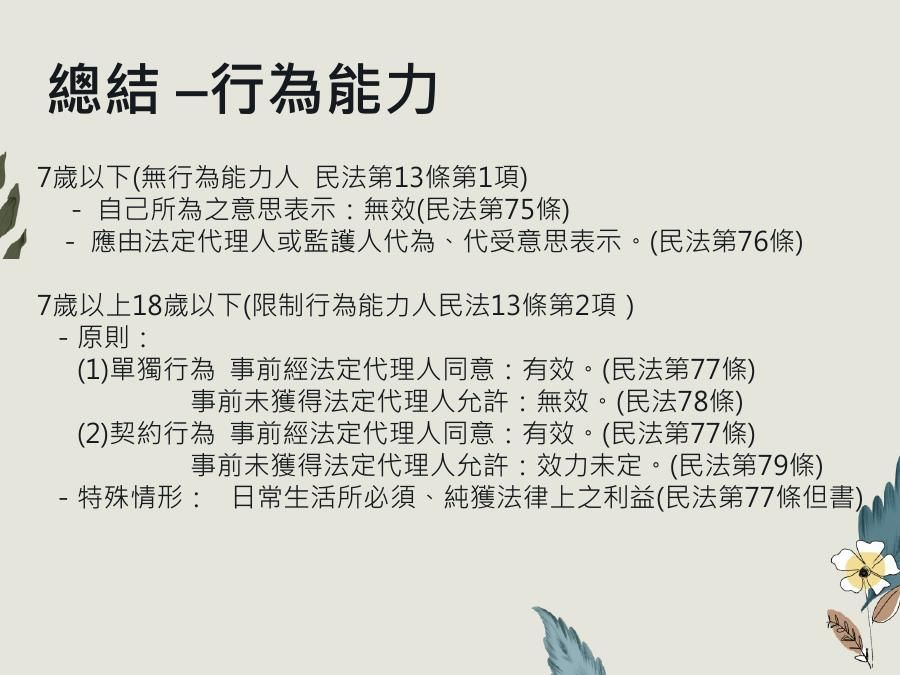

---

## 第 11 部分：限制原因消滅後的承認

### 11-1 題目

**Q17.** 再過三天就過 18 歲生日的大雄，沒有事前經過法定代理人的允許，自己跟建商簽約買了一間公寓，大雄可以自己在 18 歲生日當天自己承認買賣契約嗎？

<details>
<summary>解答</summary>

**可以。**

- 簽約時大雄未滿 18 歲 → 限制行為能力人，契約未得允許 → 效力未定（民法第 79 條）
- 18 歲生日當天成年 → 限制原因消滅 → 大雄自己承認，效力與法定代理人承認相同

> **民法第 81 條**　限制行為能力人於限制原因消滅後，承認其所訂立之契約者，其承認與法定代理人之承認，有同一效力。

</details>

---

## 第 12 部分：行為能力 2 — 無意識或精神錯亂

### 12-1 內容：戲劇案例

🖼️ 投影片圖示（民視《市井豪門》劇照）：

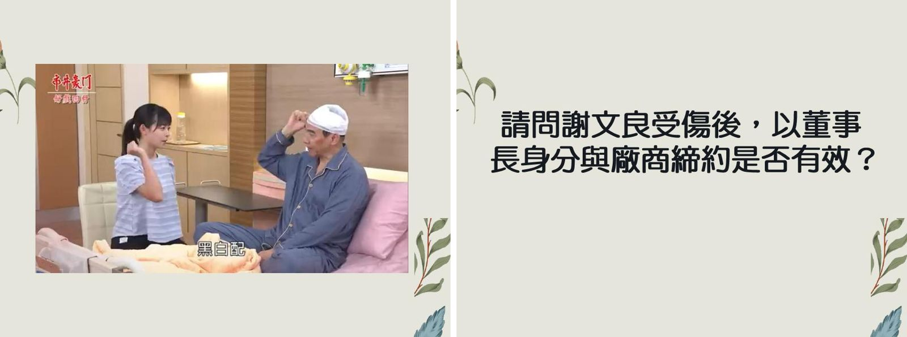

> **民法第 75 條**　無行為能力人之意思表示，無效；雖非無行為能力人，而其意思表示，係在**無意識或精神錯亂**中所為者亦同。

### 12-1 題目

**Q18.** 請問謝文良受傷後，以董事長身分與廠商締約是否有效？

<details>
<summary>解答</summary>

**無效。**（民法第 75 條後段）

📝 說明：謝文良是成年人，原本有完全行為能力；但若締約時處於「無意識或精神錯亂」狀態，意思表示一樣無效。

</details>

**Q19.** 請問如何證明是無意識狀態下締約？
（A）診斷證明書　（B）受監護宣告、輔助宣告　（C）身心障礙證明

<details>
<summary>解答</summary>

**（A）診斷證明書、（B）受監護宣告、輔助宣告**

📝 說明：身心障礙證明只表示有某種障礙，不能證明「締約當下」無意識或精神錯亂。

</details>

### 12-2 內容：總結（加上無意識或精神錯亂）

- **無意識或精神喪失**（無行為能力人，民法第 75 條後段）→ 意思表示無效
- 7 歲以下、7 歲以上 18 歲以下的規定同第 10 部分

---

## 第 13 部分：監護宣告、輔助宣告與親屬關係

### 13-1 題目：誰可以聲請？

**Q20.** 誰可以幫謝文良聲請監護宣告、輔助宣告？

🖼️ 投影片圖示（家族關係圖）：

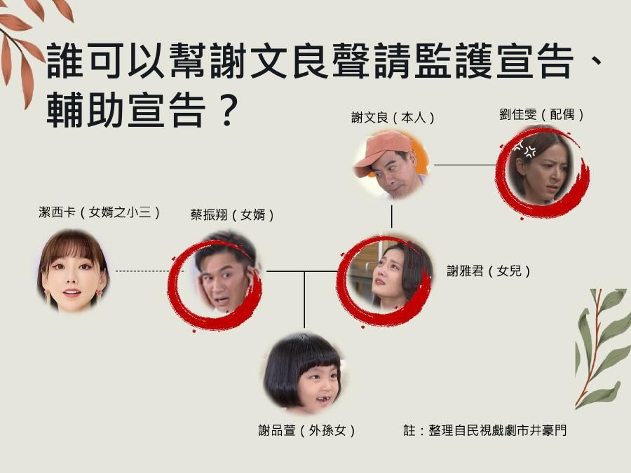

<details>
<summary>解答</summary>

投影片圈出：**劉佳雯（配偶）、謝雅君（女兒）、蔡振翔（女婿）**。潔西卡（女婿之小三）和謝文良沒有親屬關係，不能聲請。

📝 補充：民法第 14 條第 1 項的聲請權人是「本人、配偶、**四親等內之親屬**、最近一年有同居事實之其他親屬、檢察官、主管機關、社會福利機構、輔助人、意定監護受任人或其他利害關係人」。外孫女謝品萱是二等血親（見下題），也在四親等內。

</details>

### 13-2 內容：血親與姻親

> **民法第 967 條**
> 稱**直系血親**者，謂己身所從出或從己身所出之血親。
> 稱**旁系血親**者，謂非直系血親，而與己身出於同源之血親。

> **民法第 969 條**　稱**姻親**者，謂血親之配偶、配偶之血親及配偶之血親之配偶。

### 13-2 題目

**Q21.** 謝文良跟謝品萱，是血親嗎？如是，是幾等血親？

**Q22.** 謝文良跟蔡振翔，是血親還是姻親嗎？如是，是幾等？

<details>
<summary>解答</summary>

🖼️ 投影片圖示（左：二等血親；右：一等姻親）：

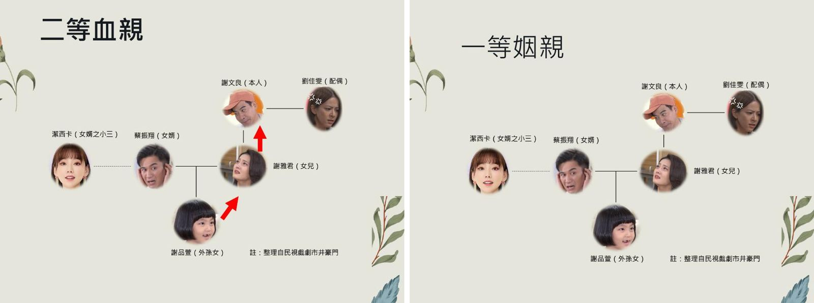

**Q21**：是，**直系二等血親**（謝品萱 → 謝雅君 → 謝文良，往上數兩代）。

**Q22**：**一等姻親**（蔡振翔是謝文良的血親〔女兒謝雅君，一等〕之配偶）。

</details>

### 13-3 題目：向誰聲請？

**Q23.** 要向哪個機關聲請監護宣告、輔助宣告？
（A）法院　（B）地檢署　（C）社會局

<details>
<summary>解答</summary>

**（A）法院**

> **民法第 1111 條**　**法院**為監護之宣告時，應依職權就配偶、四親等內之親屬、最近一年有同居事實之其他親屬、主管機關、社會福利機構或其他適當之人選定一人或數人為監護人，並同時指定會同開具財產清冊之人。

</details>

**Q24.** 應該向哪一間法院聲請監護宣告、輔助宣告？（管轄法院）
（A）監護人所在地　（B）受監護宣告人所在地　（C）受監護宣告人戶籍地

<details>
<summary>解答</summary>

**（B）、（C）**

🖼️ 投影片圖示：

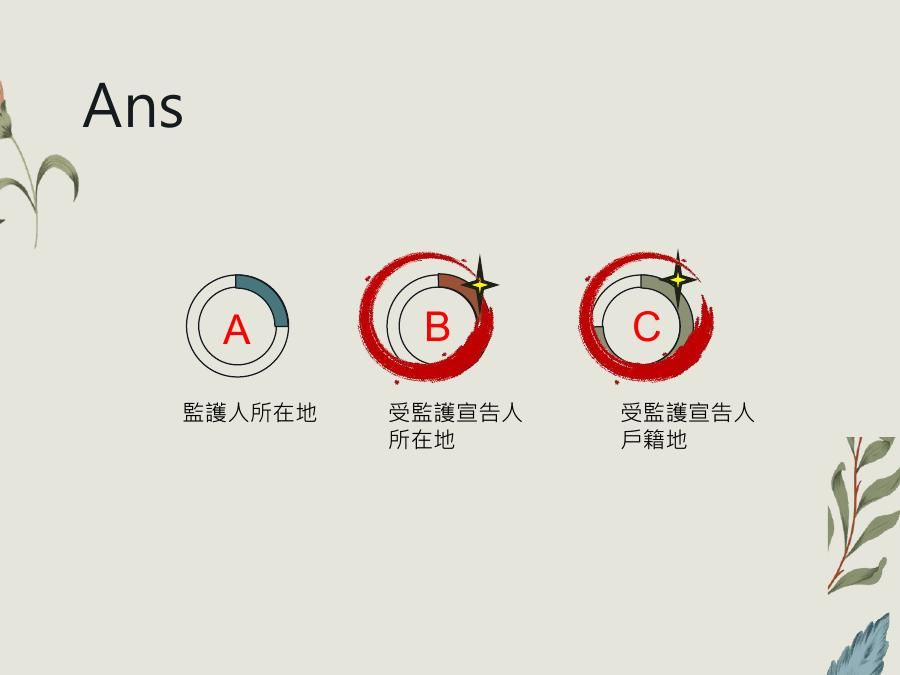

> **家事事件法第 164 條**　下列監護宣告事件，專屬應受監護宣告之人或受監護宣告之人**住所地或居所地**法院管轄；無住所或居所者，得由法院認為適當之所在地法院管轄：一、關於聲請監護宣告事件。

</details>

### 13-4 內容：精神鑑定與法院裁定

常見精神鑑定機關（高雄、台南一帶）：
- 長庚醫療財團法人高雄長庚紀念醫院
- 衛生福利部嘉南療養院
- 財團法人私立高雄醫學大學附設中和紀念醫院

🖼️ 投影片圖示（左：精神鑑定報告，結論「建議為監護宣告」；右：臺南地院 112 年度監宣字第 244 號民事裁定）：

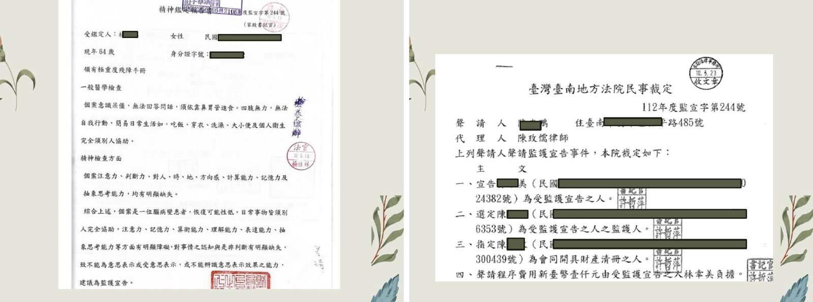

📝 裁定主文會同時：① 宣告某人為受監護宣告之人 ② 選定監護人 ③ 指定會同開具財產清冊之人（對應民法第 1111 條）。

### 13-5 題目：恢復健康之後

**Q25.** 受監護宣告的謝文良恢復健康，原本法院裁定的監護宣告會自動失效嗎？

<details>
<summary>解答</summary>

**不會。**

> **民法第 14 條第 2 項**　受監護之原因消滅時，法院應依前項**聲請權人之聲請**，撤銷其宣告。

</details>

**Q26.** 如果鑑定之後，法院認為謝文良沒有完全恢復健康，法院可以裁定輔助宣告嗎？

<details>
<summary>解答</summary>

**可以。**

> **民法第 14 條第 3、4 項**
> 法院對於監護之聲請，認為未達第一項之程度者，得依第十五條之一第一項規定，**為輔助之宣告**。
> 受監護之原因消滅，而仍有輔助之必要者，法院得依第十五條之一第一項規定，**變更為輔助之宣告**。

</details>

---

## 第 14 部分：刑事責任能力

### 14-1 法條內容

> **刑法第 19 條第 1 項及第 2 項**：行為人於行為時因精神障礙或其他心智缺陷，導致辨識能力欠缺或顯著降低，則屬**欠缺責任能力不罰**或**減輕其刑**。

> 行為時雖無責任能力，但無責任能力狀態（例如酒醉）的原因是**行為人故意或過失造成的**，為防止有人濫用無責任能力不罰的規定，特別規定這樣的行為**仍然應受刑罰**。（📝 刑法第 19 條第 3 項，學說稱「原因自由行為」）

### 14-1 題目

**Q27.** 如果是喝醉酒之後，涉犯竊盜罪，可以免除刑責嗎？

**Q28.** 如果是喝醉酒之後，涉犯不能安全駕駛罪，可以免除刑責嗎？

**Q29.** 如果領有身心障礙手冊，可以免除刑責嗎？

<details>
<summary>解答</summary>

**Q27、Q28**：📝 **原則上不行。** 酒醉是自己故意或過失喝出來的，依刑法第 19 條第 3 項不適用不罰或減刑的規定（不能安全駕駛罪更是以「酒後駕車」本身為處罰對象）。

**Q29**：📝 **不一定。** 有身心障礙手冊不等於「行為時」欠缺辨識能力；法院要透過**精神鑑定**確認違法當下的精神狀況，才決定是否不罰或減刑。

🖼️ 投影片圖示（左：法院囑託精神鑑定的函文；右：鑑定結果）：

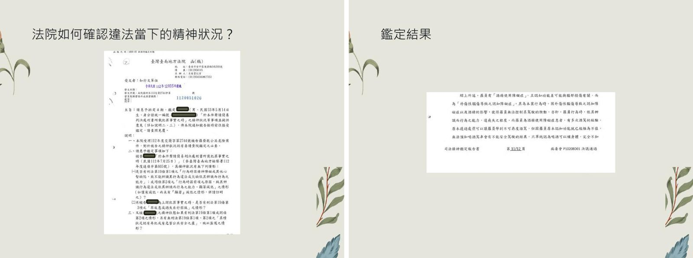

</details>

---

## 附錄：本週法條速查

| 法條 | 內容 |
|---|---|
| 民法 §12 | 滿十八歲為成年。 |
| 民法 §13 | 未滿七歲之未成年人，無行為能力。滿七歲以上之未成年人，有限制行為能力。 |
| 民法 §14 | 受監護之原因消滅時，法院應依聲請撤銷其宣告；未達監護程度者，得為輔助之宣告。 |
| 民法 §75 | 無行為能力人之意思表示，無效；雖非無行為能力人，而其意思表示，係在無意識或精神錯亂中所為者亦同。 |
| 民法 §76 | 無行為能力人由法定代理人代為意思表示，並代受意思表示。 |
| 民法 §77 | 限制行為能力人為意思表示及受意思表示，應得法定代理人之允許。但純獲法律上利益，或依其年齡及身分、日常生活所必需者，不在此限。 |
| 民法 §78 | 限制行為能力人未得法定代理人之允許，所為之單獨行為，無效。 |
| 民法 §79 | 限制行為能力人未得法定代理人之允許，所訂立之契約，須經法定代理人之承認，始生效力。 |
| 民法 §80 | 前條契約相對人，得定一個月以上之期限，催告法定代理人，確答是否承認。於前項期限內，法定代理人不為確答者，視為拒絕承認。 |
| 民法 §81 | 限制行為能力人於限制原因消滅後，承認其所訂立之契約者，其承認與法定代理人之承認，有同一效力。 |
| 民法 §83 | 限制行為能力人用詐術使人信其為有行為能力人或已得法定代理人之允許者，其法律行為為有效。 |
| 民法 §967 | 直系血親：己身所從出或從己身所出之血親；旁系血親：非直系血親，而與己身出於同源之血親。 |
| 民法 §969 | 姻親：血親之配偶、配偶之血親及配偶之血親之配偶。 |
| 民法 §1111 | 法院為監護之宣告時，應依職權選定監護人，並同時指定會同開具財產清冊之人。 |
| 家事事件法 §164 | 監護宣告事件，專屬應受監護宣告之人住所地或居所地法院管轄。 |
| 刑法 §18 | 未滿十四歲人之行為，不罰。十四歲以上未滿十八歲人之行為，得減輕其刑。滿八十歲人之行為，得減輕其刑。 |
| 刑法 §19 | 行為時因精神障礙或其他心智缺陷，辨識能力欠缺者不罰、顯著降低者得減輕其刑；故意或過失自行招致者，不適用。 |
