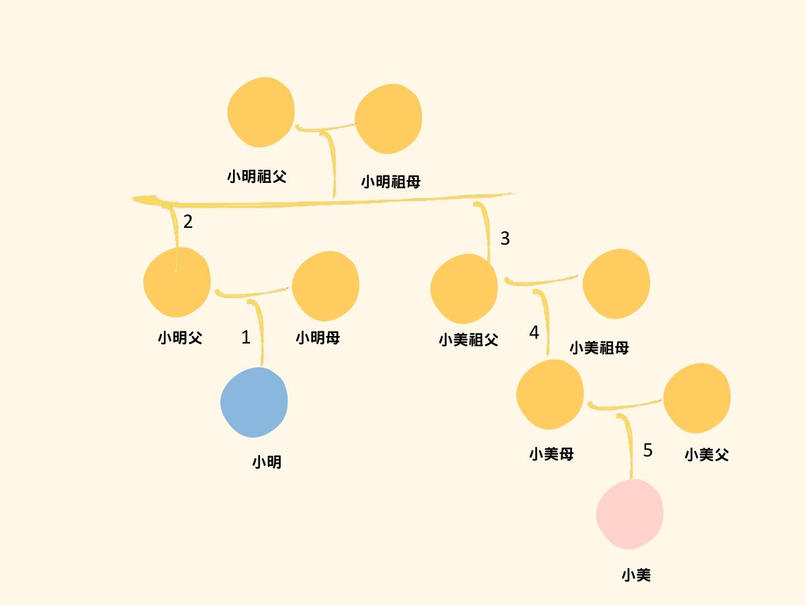
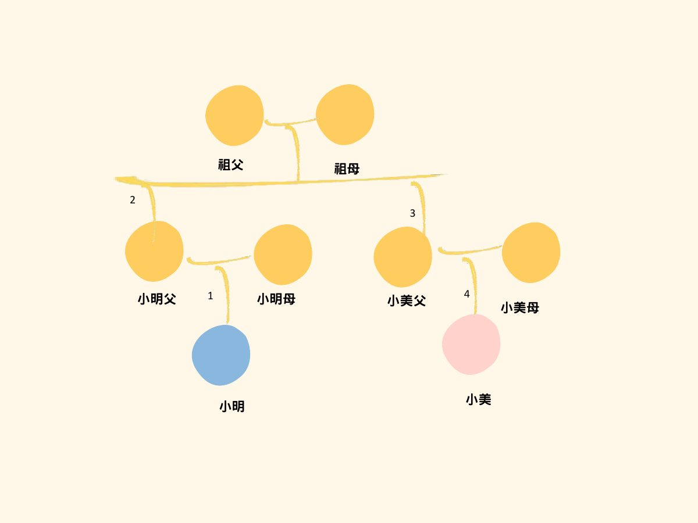
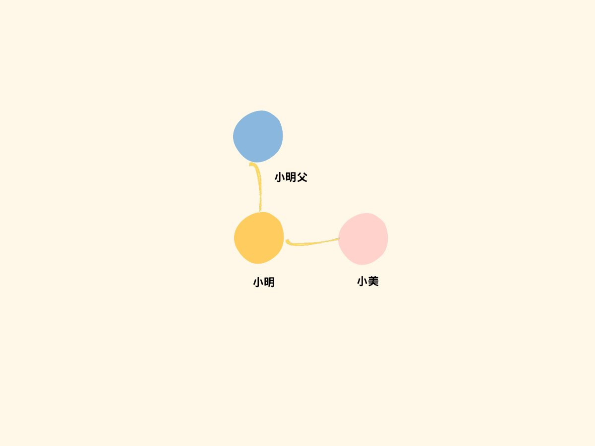
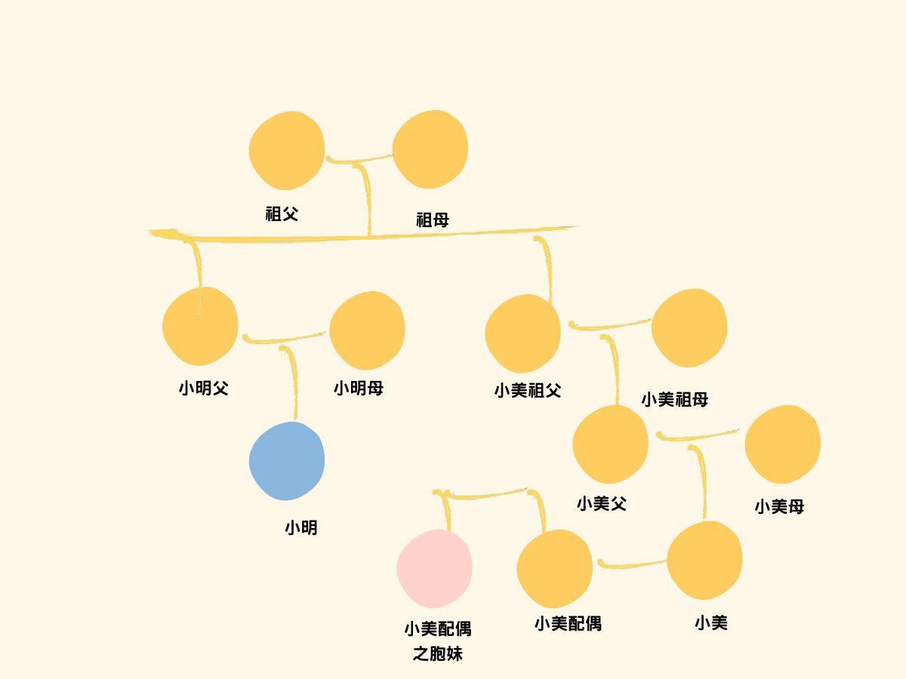
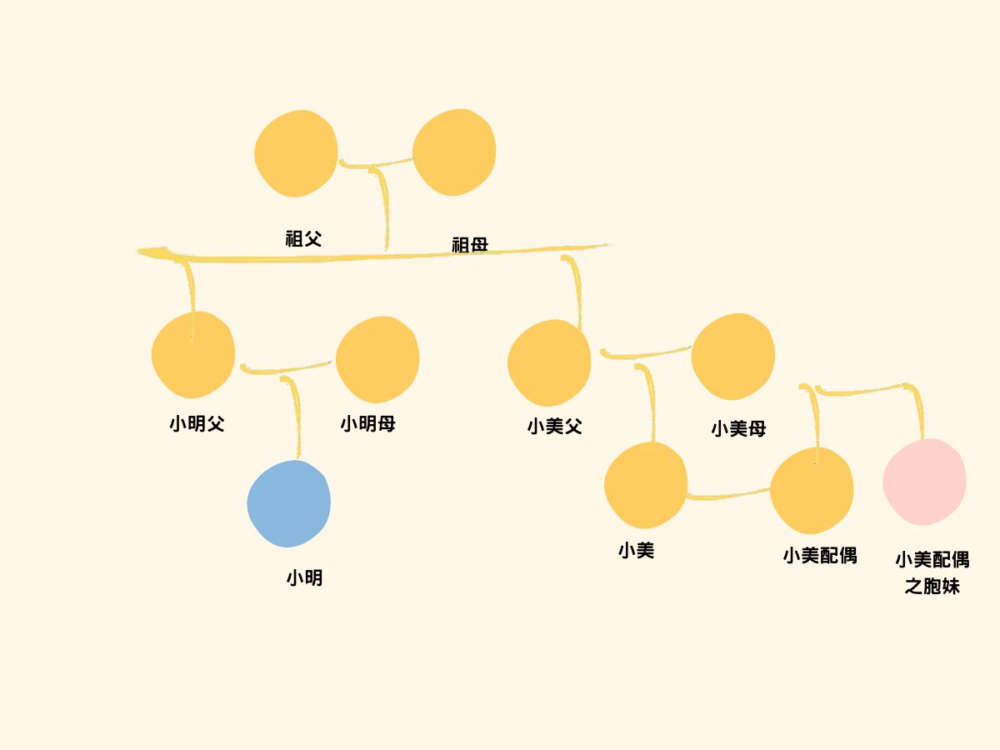
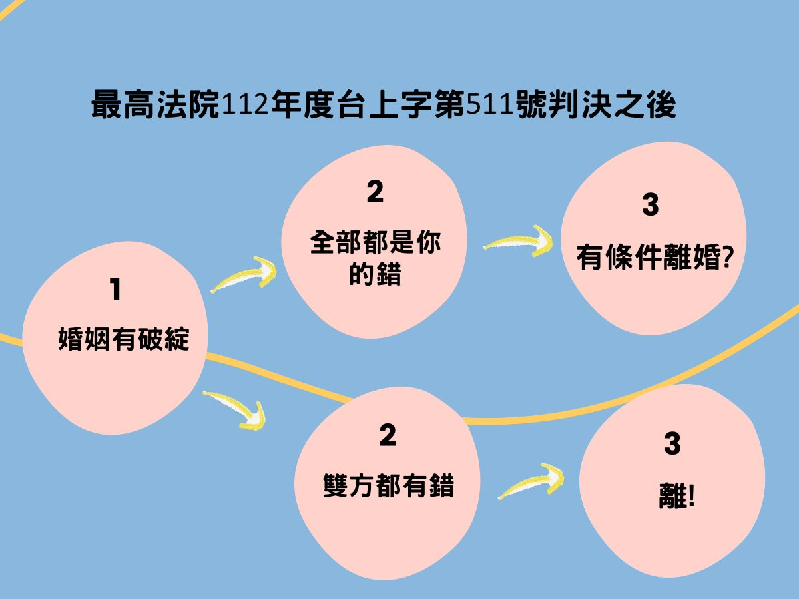

# 第 4 週（114/09/30）關於婚姻的那件事：結婚與離婚

> 來源：`第4週-1140930 (1).pdf`
>
> 讀法：每段先讀「📘 重點內容」，再做「✏️ 練習題」，最後展開「解答」對答案。
> 這份投影片的題目大多只附「法條」或「判決」而沒有直接寫出結論，解答中的結論是整理者依投影片附的法條、判決寫出；標示「📝 補充」的是投影片完全沒有的說明。
> 「🖼️ 投影片圖示」是直接從 PDF 擷取的投影片圖片。

---

## 第 0 部分：暖身活動「求婚金句」

### 📘 活動說明

1. 來前面拿一張數字
2. 不可以被別人看到

**題目：求婚金句** —— 數字代表求婚成功的機率。
找到與你數字相加最接近 100 分（絕對值）的人。

投影片上的求婚金句範例：

- 或許我成為不了最帥氣的新郎，但我會努力讓你成為最幸福的新娘
- 愛上你，就是一輩子，我能想到最浪漫的事，就是跟妳一起慢慢變老
- 如果你願意，請不要對我存有懷疑。我保證以後一定會好好疼你、好好愛你

---

## 第一部分：結婚的年齡

### 📘 重點內容

> **民法第 980 條**
> 男女**未滿十八歲**者，不得結婚。

> **民法第 989 條**
> 結婚違反第九百八十條之規定者，當事人或其法定代理人得向法院請求**撤銷**之。但當事人已達該條所定年齡或已**懷胎**者，不得請求撤銷。

### ✏️ 練習題

**Q1.** 小明跟小美兩人同年齡，且在 13 歲熱戀，兩人決定小美 **17 歲**生日當天辦理結婚登記，是否合法？

<details>
<summary>解答</summary>

**不合法。**

民法第 980 條：男女未滿十八歲者，不得結婚。17 歲未滿 18 歲。

</details>

**Q2.** 小明跟小美國中熱戀，兩人高一開學日就去辦理結婚登記，小明的法定代理人若不同意，可以撤銷結婚登記嗎？

<details>
<summary>解答</summary>

**可以。**

民法第 989 條：結婚違反第 980 條（未滿 18 歲）之規定者，當事人或其**法定代理人**得向法院請求**撤銷**之。

</details>

**Q3.** 小明跟小美國中熱戀，兩人**高一開學日發現小美懷孕**就去辦理結婚登記，小明的法定代理人若不同意，可以撤銷結婚登記嗎？

<details>
<summary>解答</summary>

**不可以。**

民法第 989 條但書：當事人已達該條所定年齡或**已懷胎**者，不得請求撤銷。

</details>

---

## 第二部分：結婚的方式

### 📘 重點內容：從「儀式婚」到「登記婚」

- **民國 19 年 12 月 26 日**，那時候的民法第 982 條清楚寫下：「結婚，應有公開儀式及二人以上之證人。」建立了「**儀式婚**」的結婚方式。
- **民國 74 年 6 月 3 日**，民法第 982 條則改為：「結婚，應有公開儀式及二人以上之證人（第一項）。經依戶籍法為結婚之登記者，推定其已結婚（第二項）。」
- **現行民法第 982 條**（登記婚）：

> **民法第 982 條**
> 結婚應以**書面**為之，有**二人以上證人之簽名**，並應由**雙方當事人**向戶政機關為結婚之**登記**。

### ✏️ 練習題

**Q4.** 結婚需要**公開宴客**嗎？

<details>
<summary>解答</summary>

**不需要。**

公開儀式是舊法「儀式婚」的要件；現行民法第 982 條採「登記婚」：書面 + 二人以上證人簽名 + 雙方當事人向戶政機關登記。

</details>

**Q5.** 結婚需要**幾個**證人？

<details>
<summary>解答</summary>

**二人以上。**（民法第 982 條：有**二人**以上證人之簽名）

</details>

**Q6.** 證人需要**陪同**到戶政事務所辦理登記嗎？

<details>
<summary>解答</summary>

**不需要。**

民法第 982 條只要求證人「**簽名**」；到戶政機關辦理登記的是「雙方當事人」。

</details>

---

## 第三部分：近親結婚的限制

### 📘 重點內容

為什麼限制近親結婚？

- **相同輩分：倫理**
- **近親：優生學**

> **民法第 983 條**
> **第一項** 與左列親屬，不得結婚：
> 一、直系血親及直系姻親。
> 二、旁系血親在六親等以內者。但因收養而成立之四親等及六親等旁系血親，輩分相同者，不在此限。
> 三、旁系姻親在五親等以內，輩分不相同者。
>
> **第二項** 前項直系姻親結婚之限制，於姻親關係消滅後，亦適用之。
>
> **第三項** 第一項直系血親及直系姻親結婚之限制，於因收養而成立之直系親屬間，在收養關係終止後，亦適用之。

> **民法第 969 條**
> 稱姻親者，謂血親之配偶、配偶之血親及配偶之血親之配偶。

### ✏️ 練習題

**Q7.** 小美的祖父，跟小明的父親是兄弟，請問小美跟小明可以結婚嗎？

<details>
<summary>解答</summary>

**不可以。**

🖼️ 投影片圖示（數字為親等計算）：



小明 →（1）小明父 →（2）小明祖父母 → 往下（3）小美祖父 →（4）小美的父母 →（5）小美。
兩人是**旁系血親五親等**，在「六親等以內」，依民法第 983 條第 1 項第 2 款不得結婚。

</details>

**Q8.** 小美的父母**收養**小美，小明的爸爸跟小美的爸爸是兄弟，請問小美跟小明可以結婚嗎？

<details>
<summary>解答</summary>

**可以。**

🖼️ 投影片圖示：



小明 →（1）小明父 →（2）祖父母 →（3）小美父 →（4）小美，是**四親等旁系血親**。
但這是「**因收養而成立**」的四親等旁系血親，且兩人**輩分相同**，適用民法第 983 條第 1 項第 2 款但書，不在禁止之列。

</details>

**Q9.** 小美與小明結婚三年後離婚，小明的爸爸可以跟小美結婚嗎？

<details>
<summary>解答</summary>

**不可以。**

🖼️ 投影片圖示：



小美是小明父的「血親（兒子）之配偶」→ **直系姻親**。
雖然離婚使姻親關係消滅，但民法第 983 條第 2 項：直系姻親結婚之限制，**於姻親關係消滅後，亦適用之**。

</details>

**Q10.** 小美的祖父與小明的父親是兄弟，請問小美的配偶的妹妹，可以跟小明結婚嗎？

<details>
<summary>解答</summary>

**可以。**

🖼️ 投影片圖示：



📝 說明：從小明來看，小美是小明的血親；小美的配偶是「血親之配偶」（姻親）；小美配偶的胞妹則是「**血親之配偶之血親**」，不屬於民法第 969 條的姻親，也不是血親，所以不受第 983 條限制。

</details>

**Q11.** 小明三年前曾經**收養**小美作為女兒，請問小明與小美**終止收養關係**後，小明可以跟小美結婚嗎？

<details>
<summary>解答</summary>

**不可以。**

民法第 983 條第 3 項：第一項直系血親及直系姻親結婚之限制，於**因收養而成立之直系親屬間，在收養關係終止後，亦適用之**。

</details>

**Q12.** 小美與小明為**堂兄妹**，請問小美的配偶的胞妹，可以跟小明結婚嗎？

<details>
<summary>解答</summary>

**可以。**

🖼️ 投影片圖示：



📝 說明：與 Q10 相同，小美配偶的胞妹對小明而言是「血親之配偶之血親」，不是姻親（民法第 969 條），也不在第 983 條第 1 項第 3 款「旁系姻親」的限制內。

</details>

---

## 第四部分：關於離婚那件事

### 📘 暖身活動「我要跟她/他 離婚！」

- 大家各自到前面來拿一張紙條，不可以給其他人看到
- 數字越大代表越容易離婚，想出相對應數字的離婚事由
- 找到跟你加起來相對值 100 的人，找到夥伴就可以坐下確認對方的分數是否正確

常見離婚原因：① 外遇！ ② 賭博！ ③ 不做家事！

### 📘 離婚統計

根據內政部統計，台灣 2024 年共 5 萬 3469 對夫妻離婚，意即每千名台灣總人口中，離婚對數比率的粗離婚率為 2.28‰，是 2019 年以來新高，在亞洲國家中位居第二。（投影片附「台灣離婚率皆破 2，疫情年有微幅下滑」長條圖）

### 📘 影片討論：《童話故事下集》（Netflix）

**這是哪一部？** → 《童話故事下集》（影片連結：https://www.youtube.com/watch?v=sVgEuDRZ5gI ）

- 我老公是**媽寶**？！
- 老公把披薩**本體**放冰箱？！
- 婆婆**逼生子**

> 誰說婚姻是修成正果？明明就是修煉的開始！

---

## 第五部分：離婚的方式

### ✏️ 練習題

**Q13.** 離婚的方式有幾種？

<details>
<summary>解答</summary>

**3 種**：① 裁判離婚 ② 調解離婚 ③ 協議離婚

</details>

**Q14.** 如果想要調解離婚，要向哪個機關聲請？

<details>
<summary>解答</summary>

**法院**

</details>

**Q15.** 法定離婚要件有幾種？

<details>
<summary>解答</summary>

民法第 1052 條第 1 項列了 **10 款**，另有第 2 項「重大事由」（見下方條文）。

</details>

### 📘 重點內容：民法第 1052 條

> **民法第 1052 條**
> **第一項**（夫妻之一方，有下列情形之一者，他方得向法院請求離婚）
> 一、重婚。
> 二、與配偶以外之人合意性交。
> 三、夫妻之一方對他方為不堪同居之虐待。
> 四、夫妻之一方對他方之直系親屬為虐待，或夫妻一方之直系親屬對他方為虐待，致不堪為共同生活。
> 五、夫妻之一方以惡意遺棄他方在繼續狀態中。
> 六、夫妻之一方意圖殺害他方。
> 七、有不治之惡疾。
> 八、有重大不治之精神病。
> 九、生死不明已逾三年。
> 十、因故意犯罪，經判處有期徒刑逾六個月確定。
>
> **第二項** 有前項以外之重大事由，難以維持婚姻者，夫妻之一方得請求離婚。但其事由應由夫妻之一方負責者，僅他方得請求離婚。

---

## 第六部分：裁判離婚案例 —— 第 1052 條第 1 項各款

**Q16.** 小明跟小美結婚後，對小美百般呵護，小美卻與同事小王發生性行為，小明提起訴訟請求離婚，法院會判准嗎？

<details>
<summary>解答</summary>

**會判准。**

符合民法第 1052 條第 1 項第 2 款「**與配偶以外之人合意性交**」。

</details>

**Q17.** 小美與小明結婚已經 45 年，但小美長期遭到小明施以肢體及言語暴力，小美起訴請求離婚，法院會判准嗎？

小美跟小明的小孩在通常保護令事件開庭時稱：

- 「我母親如不順從父親，我父親就罵髒話，還會拳打腳踢，我記得從小我父親就一個月打我母親一、二次……我父親雖身體不好，但一聽到不順耳的話，情緒就會激動，並且會有肢體動作出現」
- 「一併償還我有記憶以來，我就經常看到我父親打我母親……還會拿三字經罵我母親……八十一年至八十六年間我父母與我住在一起，也有這樣的肢體行為，最後一次是八十八年八月十五日」
- 「我父親會打我母親，罵三字經，抓她頭髮，誣指我母親交男友」、「我從國小就看到我父親打我母親，我印象最深刻是我父親將我母親壓在地上，並且拿菜刀恐嚇，」

<details>
<summary>解答</summary>

**會判准。**（第 1052 條第 1 項第 3 款「**不堪同居之虐待**」）

> **臺灣板橋地方法院民事判決八十九年度婚字第一八三號**
> - 小明毆打小美的次數之頻繁與頻率之密集，顯係**慣行毆打**。
> - 小美所受傷害之嚴重性及其年逾七十旬，子孫滿堂，非僅為人母，亦為祖母級之人，理應受晚輩尊敬崇愛，竟常遭被告毆打、**辱罵及懷疑貞操**。
> - 小明所為已侵害小美人格尊嚴與人身安全，並**逾夫妻通常所能忍受之程度**，且已危及婚姻關係之維繫，堪認小美主張其所受身體及精神上之痛苦，**已達不堪同居虐待之程度**。

</details>

**Q18.** 小明涉犯殺人未遂之罪，還在法院審理當中，但害怕被判處重刑，跟小美分居，一個人逃亡到柬埔寨五年以上，小明的配偶小美向法院聲請離婚，法院會判准嗎？

<details>
<summary>解答</summary>

**不會以「惡意遺棄」判准。**（第 1052 條第 1 項第 5 款）

> **最高法院 49 年度台上字第 1251 號民事判決**
> - 夫妻之一方以惡意遺棄他方者，不僅須有違背同居義務之客觀事實，並須**有拒絕同居之主觀情事**，始為相當。
> - 小明僅因犯殺人未遂罪逃亡在外，尚無其他情形可認具有拒絕同居之主觀要件，縱令未盡家屬扶養義務，亦與有資力而無正當理由不為支付生活費用者有別。

</details>

**Q19.** 小明因為涉犯加重詐欺罪遭一審法院判處兩年十個月，小明**提出上訴**，小明的配偶小美向法院提出離婚聲請，法院會判准嗎？

<details>
<summary>解答</summary>

**不會依第 10 款判准**，因為判決還沒「確定」。

第 10 款要件：因故意犯罪，經判處有期徒刑逾六個月**確定**。

- 一、**通常救濟程序**：對於未確定之裁判，依裁判性質區分「裁定」或「判決」，而分別有抗告或上訴第二、三審審判程序。
- 二、**特別救濟程序**：**已確定**之判決，另可依再審或非常上訴途徑再為救濟。

小明已提出上訴，一審判決尚未確定。

</details>

### 📘 重點內容：「不治之惡疾」（第 7 款）的判斷

**不構成「不治之惡疾」的三個要素：**

1. 非常情厭惡
2. 不危害配偶健康
3. 可控制、治療

**Q20.** 小明婚後罹患糖尿病、肝癌，小明的配偶小美向法院提出離婚訴訟，法院會判准嗎？

<details>
<summary>解答</summary>

**不會判准。**（不構成不治之惡疾）

> **臺灣新北地方法院 109 年度婚字第 450 號民事判決**
> 小明稱：曾因血糖因素稍有不適，但經醫師診治後，已恢復正常，肝癌部分已切除，不用化療，已經痊癒了。
> 法院：
> - 現今**醫學發達**，無論係糖尿病或癌症，均有相關藥物得以控制、治療
> - 該等疾病於現今**社會中實屬常見，並非常情所厭惡**，亦**不致危害配偶之健康**
> - 是小明雖曾有血糖問題，並曾罹患肝癌，**尚難認定**係屬民法第 1052 條第 1 項第 7 款規定之「不治之惡疾」

</details>

**Q21.** 小明婚後患有愛滋病，小明的配偶小美向法院提出離婚聲請，法院會判准嗎？

<details>
<summary>解答</summary>

**會判准。**（屬不治之惡疾）

> **臺灣基隆地方法院 100 年度婚字第 214 號民事判決**
> - 愛滋病**傳染病**，此種病毒可侵犯並破壞人體免疫系統，或發生與免疫有關的癌症，最後**導致死亡**。
> - 此病症並經政府訂有「人類免疫缺乏病毒傳染防治及感染者權益保障條例」加以防治，並禁止感染者與他人進行危險性行為，違反者尚構成刑事犯罪
> - 愛滋病之治療，雖已用雞尾酒式混合療法藥物，得以控制病情，延緩發病時間，但均**非根治**之藥物，且**副作用大**；
> - 是以，依目前國內、外醫藥科學研究及技術，對該病症仍無法以醫藥學之方法加以「根治」，是該病症確屬不治之惡疾。

</details>

---

## 第七部分：裁判離婚案例 —— 第 1052 條第 2 項「重大事由」

**Q22.** 小明婚後因公受傷，因傷及脊髓神經故領有重度殘障且無法人道，小明的配偶小美向法院提出離婚訴訟，法院會判准嗎？

<details>
<summary>解答</summary>

**會判准。**（第 1052 條第 2 項重大事由）

> **臺灣高雄地方法院 90 年度婚字第 1071 號民事判決**
> - 本件小明既受傷傷及背髓神經，而成重度殘障**無法人道**，則雙方不僅**無法再透過此一婚姻關係獲得更多幸福**，且本件婚姻之維繫反有可能徒增雙方之痛苦，是雙方之婚姻實難再以維持
> - 小美依民法第一千零五十二條第二項規定，主張有重大事由難以維持婚姻訴請與被告離婚，自無不合，應予准許。

</details>

**Q23.** 小美婚後與小明的生活習慣不同、金錢觀念不合，小美向法院聲請離婚，法院會判准嗎？

- **金錢觀念不合**：家裡由小明管理錢，小美結婚後五年竟然發現家裡沒有存款，所以改由小美管理錢、處理家用，但小明認為我給的錢太少。
- **生活習慣不佳**：小明衣物堆放，使用後的餐盤、烤箱都不清潔，平常衛生習慣不佳，導致櫥櫃下方有蜘蛛網。

<details>
<summary>解答</summary>

**不會判准。**

> **臺灣高雄少年及家事法院 107 年度婚字第 369 號民事判決**
> - 婚姻係兩造為營永久共同生活，並使雙方人格得以實現與發展之生活共同體。因婚姻而生之永久結合關係，不僅使夫妻在精神上、物質上互相依存，並延伸為家庭與社會之基礎。而夫妻本來自不同之原生家庭，其因價值觀念、習俗禮節、生活習慣差異於婚姻過程中發生爭執磨擦，乃社會所常見，**非不得透過日後之相互調整、尊重、忍讓而取得共識，獲得改善**。
> - 雙方就家庭、金錢觀念等有不一致之情形，不能推得婚姻存有重大事由之**破綻**。
> - 整理家務之清潔精細程度，因人而異，小美所提出之照片縱然顯示家庭整潔程度稍有不足，但家務分擔、**分工本需夫妻溝通討論**，非逕落於一方之責。
> - 因此本件小美無法跟小明離婚。

</details>

### 📘 重點內容：什麼是「破綻」？

- 白話來說，一般人在一樣的情況之下，也認為無法維繫婚姻的程度。
- 更白話來說，**如果我是他，我也會離婚！**

### 📘 重點內容：有責配偶可以請求離婚嗎？

**以前** —— 民法第 1052 條第 2 項離婚事由，考慮：

1. 婚姻有破綻
2. 是誰導致婚姻有問題的？
3. 誰的問題比較大？

> **最高法院 112 年度台上字第 511 號民事判決**
> - 一律不許唯一有責之配偶一方請求裁判離婚，形同強迫其繼續面對已出現重大破綻難以維持之漸行漸遠或已處於水火之中之形骸化婚姻關係，完全**剝奪其離婚之機會**，可能導致個案顯然過苛之情事，與憲法保障無責配偶維持婚姻之自由間，有求其衡平之必要。
> - 又依憲法法庭 112 年憲判字第 4 號判決，夫妻有民法第 1052 條第 1 項規定以外之重大事由，難以維持婚姻者，就該事由應**負完全責任之一方**，於一定條件下，仍得請求與無責任之他方離婚。則就該事由應**負較重責任之一方**，自得請求與責任較輕之他方離婚。

**最高法院 112 年度台上字第 511 號判決之後：**

```
① 婚姻有破綻 ─┬→ ② 全部都是你的錯 → ③ 有條件離婚？
              └→ ② 雙方都有錯     → ③ 離！
```

🖼️ 投影片圖示：



**Q24.** 小美跟小明婚後因為家庭開支心生嫌隙後**分居七年**，雙方並無互動，小美是否可以據此提出離婚訴訟？

<details>
<summary>解答</summary>

**可以，法院判准。**

> **臺灣士林地方法院 109 年度婚字第 207 號民事判決**
> - 雙方因家庭開支問題發生爭執，雙方感情確生嫌隙，並繼續**分居長達 7 年以上**，各自生活，關係未見改善。
> - 又婚姻生活貴在夫妻彼此**身心合一**，然兩造長期分居至今，**顯非正常夫妻相處之道**，雙方徒有夫妻之名而無夫妻之實，與夫妻以共同生活、同甘共苦、共創幸福家庭生活之本質相悖
> - 故兩造欲自對方獲得婚姻生活之安全、幸福及圓滿，無異緣木求魚，殊不可得，亦無從期待兩造能繼續經營和諧幸福之婚姻生活。

</details>

**Q25.** 請問**小美**可以提出離婚訴訟，法官會判准嗎？

- 小明跟小美常常因為返回娘家的事情起爭執，
- 小美出手毆打小明，導致小明受傷。
- 小美更換門鎖不讓小明回家。
- 雙方分居七年。
- 小明多次表示想回家。

<details>
<summary>解答</summary>

**不會判准。**

> **臺灣臺北地方法院 112 年度婚字第 321 號民事判決**
> - 雙方分居的主因是小美對小明施以家暴。
> - 小美又拒絕讓小明返家同住，甚至更換門鎖所致，被告對於雙方分居之情形，小明實際上沒有過錯。
> - 所以小美才是導致婚姻破裂的**唯一應該負責任之一方**，小美主張離婚，法院不准。

</details>

**Q26.** 小明跟小美婚後感情不佳，小明會傳送以下訊息給小美，請問小美是否可以提出離婚訴訟？

> 「去死吧」、「為什麼你不去死」、「屁話留著自己用，趕論文，你的話能聽幾分，謊話連篇」、「你為什麼不去死，趕論文，都要口試，還趕論文，講個比較讓人相信的理由吧」「別玩到人財兩失」。「記得穿辣點，40好幾需要穿不一樣的否則效果不好。不然你沒辦法更上一層樓」

<details>
<summary>解答</summary>

**可以，法院判准。**

> - 小明用語極端激烈，甚至揶揄、**物化小美**，對小美係全然負面之評價，且屬侮辱、羞辱、**鄙視小美人格尊嚴**之言詞。
> - 即便是一般人間，聽聞上開言論，均會感受到言詞暴力及精神侵害，更遑論雙方係夫妻關係，遭自己配偶施以如此不堪之言語攻擊。
> - 雙方婚姻客觀上已難期修復，無法繼續婚姻共同生活，若仍強求維持婚姻之名，而無婚姻之實，不僅無法改善現況，反徒增兩造於矛盾中歲月虛度。
> - 故**依社會上一般觀念為體察，任何人處於同一情況下，均不願繼續維持婚姻生活**，本件兩造間之婚姻已生**破綻**而無回復之希望，有不能維持婚姻之重大事由。而就雙方長期以來皆未能協力謀求夫妻感情之和諧，及就前揭爭執之**責任歸屬**，比較衡量雙方之有責程度，應認**小明具有較高之可歸責性**。從而，小美依民法第 1052 條第 2 項規定請求判決其與小明離婚，為有理由，應予准許。

</details>

---

## 第八部分：我們和平的離婚吧！（協議離婚範例）

投影片上的協議內容：

| 項目 | 約定 |
| --- | --- |
| 小孩 | 陳小美，101 年 1 月 2 日出生；監護權歸男方，女方可以探視陳小美 |
| 財產 | 雙方財產各自處理 |
| 搬遷 | 女方於 114.4.2 從男方家搬出去，物品請一併帶走 |

（下課啦！）

---

## 📋 速記總整理

| 主題 | 一句話記住 |
| --- | --- |
| 結婚年齡 | 未滿 18 歲不得結婚（§980）；可撤銷，但已滿 18 或已懷胎不得撤銷（§989） |
| 結婚方式 | 書面 + 二人以上證人簽名 + 雙方當事人到戶政登記（§982）；不必宴客、證人不必到場 |
| 近親禁婚 | 直系血親、直系姻親；旁系血親六親等內；旁系姻親五親等內且輩分不同（§983Ⅰ） |
| 收養例外 | 因收養而成立的四、六親等旁系血親，輩分相同 → 可以結婚 |
| 關係消滅後 | 直系姻親離婚後仍禁婚（§983Ⅱ）；收養終止後直系仍禁婚（§983Ⅲ） |
| 非姻親 | 血親之配偶之血親（如自己 vs 堂表兄弟姊妹的配偶的兄弟姊妹）→ 不受禁婚限制 |
| 離婚方式 | 裁判、調解（向法院）、協議 |
| 惡意遺棄 | 要有客觀不同居 + 主觀拒絕同居 |
| 判刑離婚 | 故意犯罪、逾 6 個月、**確定** |
| 不治之惡疾 | 常情厭惡、危害配偶健康、無法控制治療（愛滋 ✓；糖尿病、癌症 ✗） |
| 重大事由 | 看「破綻」：任何人處於同一情況都不願維持婚姻 |
| 有責配偶 | 112 台上 511 / 112 憲判 4 後：雙方都有錯 → 責任較重者也可請求；完全有責 → 一定條件下可以 |
