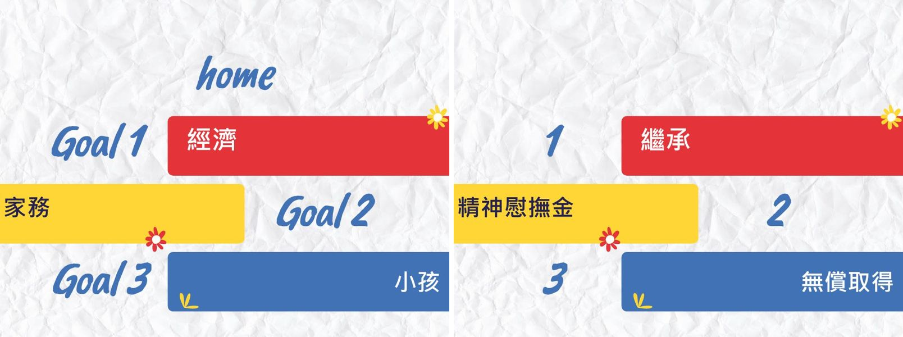
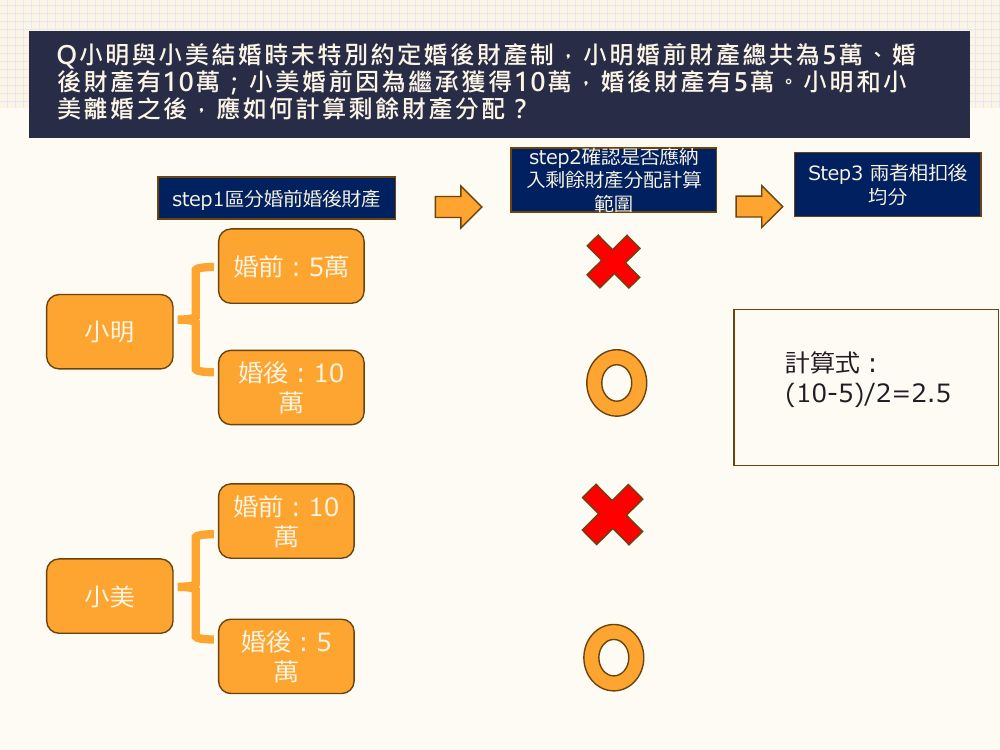
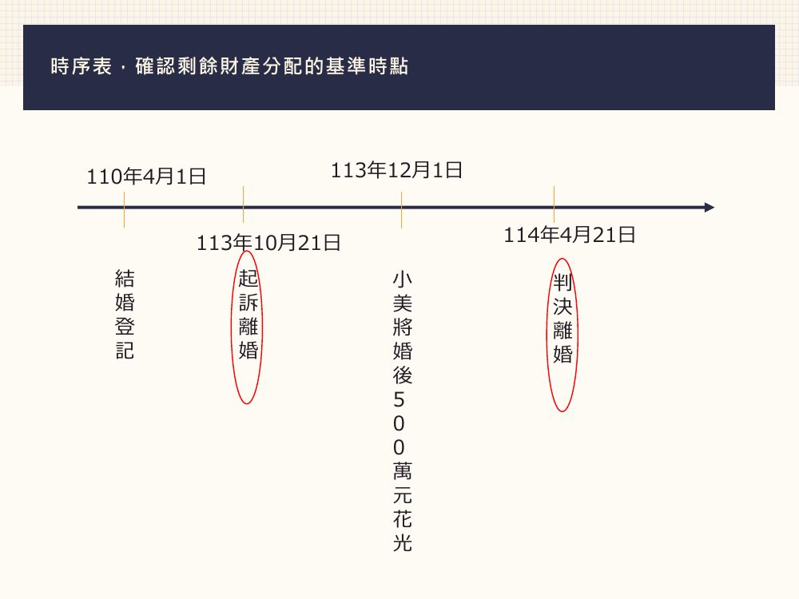
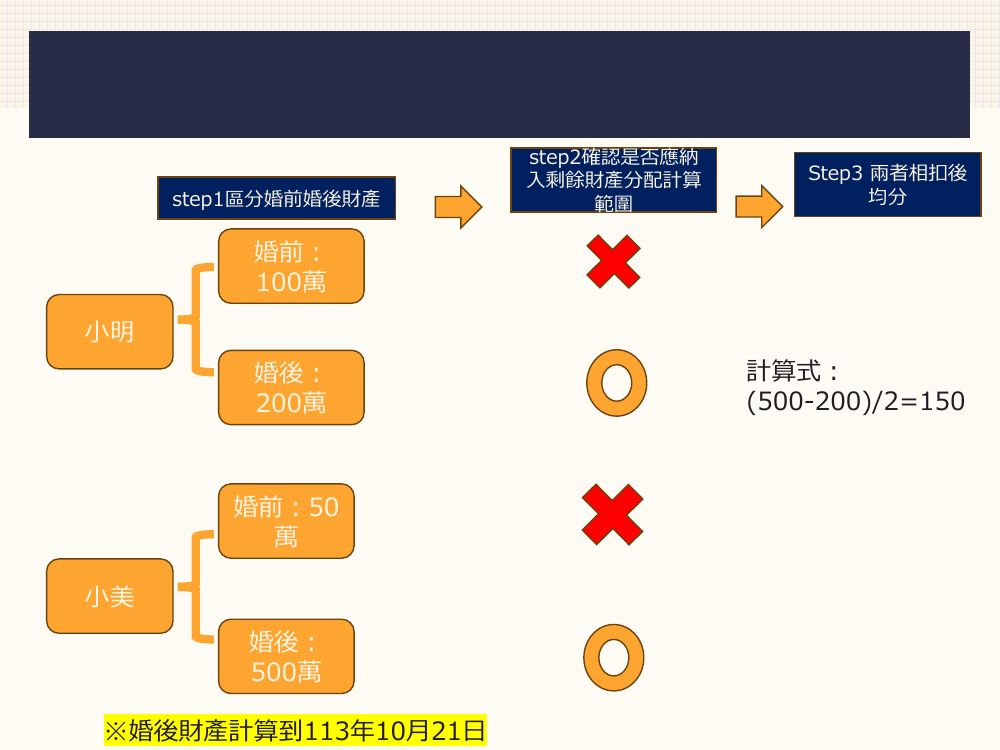
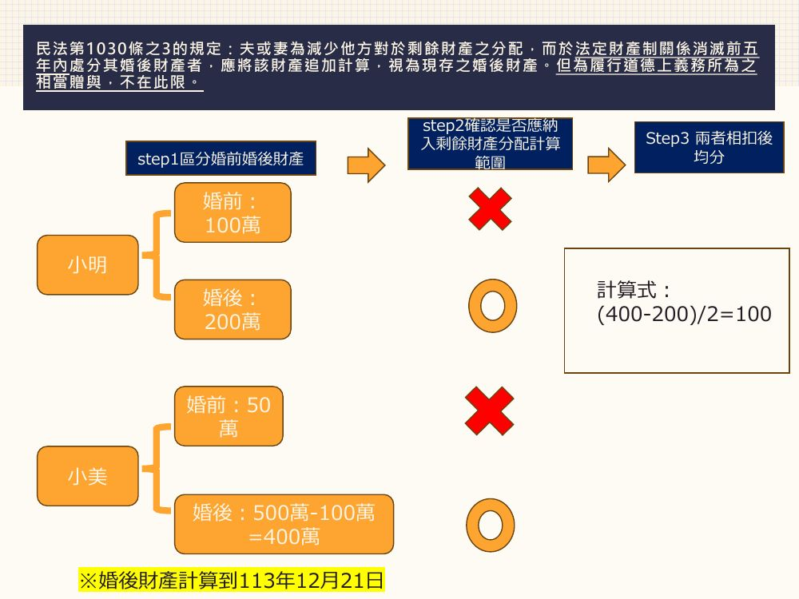
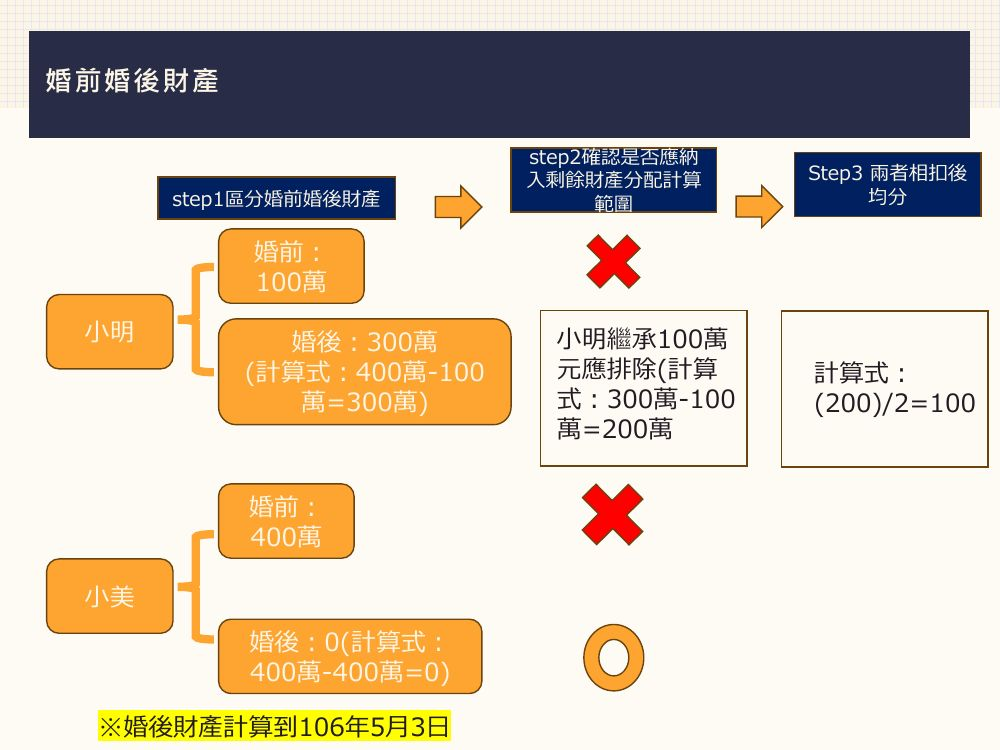
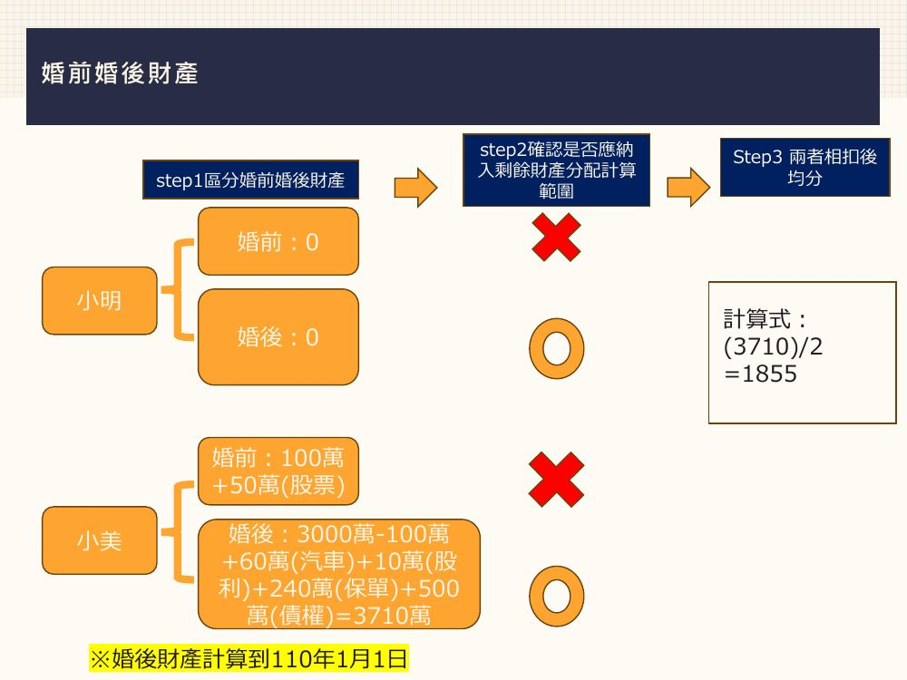
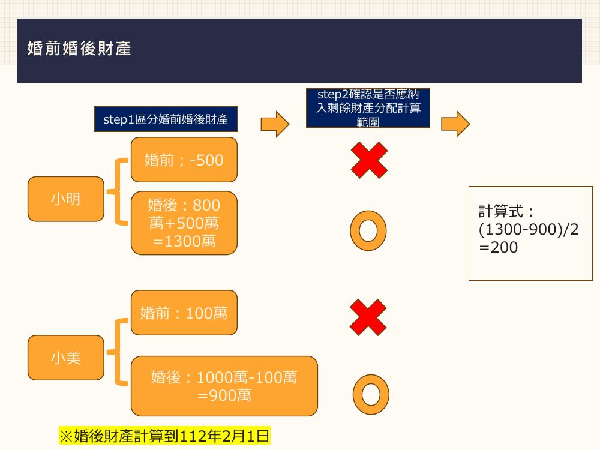

# 性別平權與生活法律（第七週）：剩餘財產分配

> 陳玫儒律師｜115.10.22
>
> 讀法：每段先讀「📘 重點內容」，再做「✏️ 練習題」，最後展開「解答」對答案。
> 「🖼️ 投影片圖示」是直接從 PDF 擷取的投影片圖片。
> 標示「📝 補充」的部分是投影片上沒有寫出、由整理者補上的說明。

---

## 暖身：經營「家」這間公司

### 📘 重點內容

- 經營「家」需要處理哪些事情？幫這些事情的**重要程度**和**辛苦程度**排名。
- 家的三個目標：**經濟**、**家務**、**小孩**。
- 與維繫「家」沒關係，但卻獲得的財產：**繼承**、**精神慰撫金**、**無償取得** → 這三種**不列入**剩餘財產分配。

🖼️ 投影片圖示：

**立法理由**

> 夫在外工作，或經營企業，妻在家操持家務，教養子女，備極辛勞，使夫得無內顧之憂，專心發展事業，其因此所增加之財產，不能不歸功於妻子之協力，則其剩餘財產，除因繼承或其他無償取得者外，妻自應有平均分配之權利，反之夫妻易地而處，亦然。

---

## 一、剩餘財產分配 vs. 贍養費

### 📘 重點內容：剩餘財產分配

> **民法第 1030 條之 1 第 1 項**
> 法定財產制關係消滅時，夫或妻現存之**婚後財產**，扣除婚姻關係存續所負債務後，如有剩餘，其雙方剩餘財產之差額，應**平均分配**。但下列財產不在此限：
> 一、因**繼承或其他無償取得**之財產。
> 二、**慰撫金**。

- **性質**：立法者就夫或妻對家務、教養子女及婚姻共同生活貢獻所作之法律上評價。
- **要件**：
  1. 婚後取得的財產
  2. 在婚姻關係（法定財產制關係）消滅時
  3. 婚後財產淨值**較少**的一方，可以向另一方主張剩餘財產差額分配請求權。
- **時效**（§1030-1Ⅴ）：自請求權人**知有剩餘財產之差額時起 2 年**間不行使而消滅；自法定財產制關係**消滅時起逾 5 年**者，亦同。

### 📘 重點內容：贍養費

> **民法第 1057 條** 夫妻無過失之一方，因**判決離婚**而陷於生活困難者，他方縱無過失，亦應給與相當之贍養費。

- **要件**：
  1. **判決離婚**
  2. 生活有困難：沒財產 ＋ 沒有謀生能力
  3. 對婚姻關係沒有過失
- **時效**：依民法 §126，**5 年**間不行使而消滅。

| | 剩餘財產分配 | 贍養費 |
| --- | --- | --- |
| 條文 | §1030-1 | §1057 |
| 什麼時候 | 法定財產制關係消滅（離婚、一方死亡…） | 只限**判決離婚** |
| 誰可以請求 | 婚後財產較少的一方 | 無過失且生活困難的一方 |
| 時效 | 知悉起 2 年／消滅起 5 年 | 5 年 |

### ✏️ 練習題

**Q1.** 剩餘財產分配是贍養費嗎？

解答

**不是。**

剩餘財產分配是對婚姻貢獻的評價（§1030-1）；贍養費是判決離婚後生活困難的救濟（§1057），兩者要件不同。

**Q2.** 小明與小美 113 年 8 月 21 日協商離婚，於一個月後前往戶政事務所為離婚登記。小美名下無財產，且對於離婚原因無過失，請問小美可以向小明請求贍養費嗎？

解答

**不可以。** 贍養費限於**裁判離婚**。

**Q3.** 小明與小美結婚時未約定財產制，數年後小明向法院聲請要與小美離婚，小明跟小美在調解程序時達成離婚和解。請問和解之後，小明可以向小美請求剩餘財產分配嗎？

解答

**可以。**

未約定財產制 → 適用法定財產制；和解離婚也是「法定財產制關係消滅」，就可以依 §1030-1 請求。

---

## 二、一方死亡：剩餘財產分配與繼承可以併存

### ✏️ 練習題

**Q4.** 小明與小美結婚時未約定財產制，小明死亡後留有遺產，請問小美可以同時「請求剩餘財產分配」以及「遺產分配」嗎？

解答

**可以。**

> **最高法院 101 年度台上字第 941 號判決意旨**
> 法定財產制關係消滅時，夫或妻之剩餘財產差額分配請求權，乃立法者就夫或妻對家務、教養子女及婚姻共同生活貢獻所作之法律上評價；與繼承制度，係因人死亡，由具有一定身分之生存者，包括的繼承被繼承人財產上之權利義務之規範目的未盡相同，配偶之夫妻剩餘財產差額分配請求權與繼承權，**性質上本可相互併存**。

### 📘 重點內容：小結

- 夫妻剩餘財產分配請求權情況一：**離婚**。
- 夫妻剩餘財產分配請求權情況二：**一方死亡**。

> 夫妻一方死亡亦屬法定財產關係消滅之原因之一（參臺灣高等法院暨所屬法院 89 年度法律座談會民事類提案第 8 號研討結果），故如夫妻一方死亡時，生存之他方係享有剩餘財產分配請求權時，於裁判分割遺產時，應就全部遺產**先扣除**該部分剩餘財產，分配予該生存之配偶後，其餘部分遺產**再由繼承人按應繼分分割**。（臺灣高等法院臺中分院 109 年度重家上字第 10 號民事判決）

---

## 三、法定財產制 vs. 分別財產制

### 📘 重點內容

| 法定財產制 | 分別財產制 |
| --- | --- |
| 婚前或婚後未以契約訂立夫妻財產制時，**當然適用** | 須以契約約定 |
| **民法 §1017**：夫或妻之財產分為婚前財產與婚後財產，由夫妻各自所有。不能證明為婚前或婚後財產者，**推定為婚後財產**；不能證明為夫或妻所有之財產，**推定為夫妻共有**。 | **民法 §1044**：分別財產，夫妻各保有其財產之所有權，各自管理、使用、收益及處分。 |
| 夫或妻婚前財產，於婚姻關係存續中所生之**孳息，視為婚後財產**。 | 雙方的財產完全分開，不論婚前婚後都各自計算 |
| 夫妻以契約訂立夫妻財產制後，於婚姻關係存續中改用法定財產制者，其改用前之財產視為婚前財產。 | **沒有**剩餘財產分配的適用 |

**法定財產制的內容**

1. 區分兩大項（原則以婚前婚後作為時點區分）：
   - 婚前財產：結婚前的積極、消極財產
   - 婚後財產：原則上是結婚之後直到法定財產制消滅時取得的積極、消極財產
   - 例外：結婚後取得、但**不屬於**婚後財產（不列入分配）的：**繼承、無償取得、慰撫金**
2. 權利義務：各自管理、使用、收益、處分自己的財產；各自清償債務。

**分別財產制的登記**

- 民法 §1007：夫妻財產制契約之訂立、變更或廢止，應以**書面**為之。
- 民法 §1008：夫妻財產制契約之訂立、變更或廢止，**非經登記，不得以之對抗第三人**。
- 民法 §1012：夫妻於婚姻關係存續中，得以契約廢止其財產契約，或改用他種約定財產制。

### ✏️ 練習題

**Q5.** 小明與小美結婚時約定分別財產制，請問小美與小明離婚後，小美可以向小明請求剩餘財產分配嗎？

解答

**不可以。** §1030-1 只適用於「**法定財產制**」關係消滅時。

**Q6.** 小明與小美於 110 年 4 月 1 日結婚登記，並特別向法院聲請為分別財產制。結婚登記之前小明有存款 50 萬元，小美有存款 100 萬元，婚後兩人一起努力共同理財，共同投資不動產事業。小明於 113 年 10 月 22 日與小美協議離婚，協議離婚前小明的財產有 5000 萬，小美的財產有 3000 萬。請問何人可以請求剩餘財產分配？若可以，可以請求多少錢？

解答

**都不可以。** 分別財產制沒有剩餘財產分配的適用。

**Q7.** 法定財產制需要向法院聲請登記嗎？

解答

**不需要。** 法定財產制乃是未以契約訂立夫妻財產制時，當然適用之夫妻財產制。

**Q8.** 分別財產制需要向法院聲請登記嗎？

解答

**需要**，應以書面向法院聲請登記（§1007、§1008）。

📝 說明：嚴格來說，不登記在夫妻之間仍有效，只是「不得以之對抗第三人」。

**Q9.** 向哪個管轄法院聲請分別財產制？

- A）戶籍地
- B）結婚登記之戶政事務所所在地

解答

**A）戶籍地**

---

## 四、剩餘財產分配的計算三步驟

### 📘 重點內容

1. **Step 1：區分婚前、婚後財產**
2. **Step 2：確認是否應納入剩餘財產分配計算範圍**（婚前財產 ✗；婚後財產 ○，但排除繼承、無償取得、慰撫金）
3. **Step 3：兩者相扣後均分** → （多的一方 − 少的一方）÷ 2，由少的一方向多的一方請求

### ✏️ 練習題

**Q10.（範例）**
小明與小美結婚時未特別約定婚後財產制，小明婚前財產總共為 5 萬、婚後財產有 10 萬；小美婚前因為繼承獲得 10 萬，婚後財產有 5 萬。小明和小美離婚之後，應如何計算剩餘財產分配？

解答

🖼️ 投影片圖示：

| | 婚前 | 婚後 | 列入計算 |
| --- | --- | --- | --- |
| 小明 | 5 萬 ✗ | 10 萬 ○ | 10 萬 |
| 小美 | 10 萬（婚前繼承）✗ | 5 萬 ○ | 5 萬 |

計算式：(10 − 5) ÷ 2 = **2.5 萬** → 小美可向小明請求 2.5 萬元。

---

## 五、計算的基準時點（民法 §1030-4）

### 📘 重點內容

> **民法第 1030 條之 4 第 1 項**
> 夫妻現存之婚後財產，其價值計算以**法定財產制關係消滅時**為準。但夫妻**因判決而離婚者，以起訴時為準**。

### ✏️ 練習題

**Q11.** 小明與小美於 110 年 4 月 1 日結婚並未特別約定財產制，小明於 113 年 4 月 1 日發現小美外遇，小明於 113 年 10 月 21 日向法院提出離婚請求，最後法院在 114 年 4 月 21 日**判決**准予小明與小美離婚。

110 年 4 月 1 日之前，小明有 100 萬存款，小美有 50 萬存款；110 年 4 月 1 日之後，小明再多出 200 萬存款，小美再多出 500 萬存款。小美在 113 年 12 月 1 日把 500 萬的存款全部花光，請問現在小明向小美請求剩餘財產應如何計算？

解答

**小明可向小美請求 150 萬元。**

🖼️ 投影片圖示（時序表）：

- 判決離婚 → 以**起訴時（113 年 10 月 21 日）**為準。
- 小美 113 年 12 月 1 日才花光，起訴時那 500 萬還在。

計算式：(500 − 200) ÷ 2 = **150 萬**

**Q12.** 小明與小美於 110 年 4 月 1 日結婚並未特別約定財產制，小明於 113 年 4 月 1 日發現小美外遇，小明於 113 年 8 月 1 日向法院提出離婚請求，雙方於 114 年 12 月 1 日在法院**達成和解離婚**。

110 年 4 月 1 日之前，小明有 100 萬存款，小美有 50 萬存款；110 年 4 月 1 日之後，小明再多出 200 萬存款，小美再多出 500 萬存款。小美在 113 年 10 月 1 日收到法院開庭通知調解離婚當天，立即將 500 萬的存款提領並全部花光，請問現在小明向小美請求剩餘財產應如何計算？

解答

**小明可向小美請求 150 萬元。**

- 投影片以起訴時（113 年 8 月 1 日）計算婚後財產：小明 200 萬、小美 500 萬。
- 計算式：(500 − 200) ÷ 2 = **150 萬**

📝 補充：§1030-4 但書條文只寫「判決」離婚以起訴時為準；和解離婚若以和解成立時為準，小美的 500 萬雖已花光，但她是為減少小明的分配而在消滅前 5 年內處分，依下一節的 §1030-3 仍要**追加計算**，結果同樣是 150 萬。

---

## 六、防範脫產：追加計算（民法 §1030-3）

### 📘 重點內容

> **民法第 1030 條之 3 第 1 項**
> 夫或妻為**減少他方對於剩餘財產之分配**，而於法定財產制關係消滅前**五年內**處分其婚後財產者，應將該財產**追加計算，視為現存之婚後財產**。但為**履行道德上義務所為之相當贈與**，不在此限。

### ✏️ 練習題

**Q13.** 如果雙方已經準備離婚，但對方卻偷偷脫產或隱匿財產該怎麼辦？在主張夫妻剩餘財產分配請求權前是否可以事先防範呢？

解答

依 **民法 §1030-3**，在法定財產制關係消滅前 5 年內，為減少他方分配而處分的婚後財產，要追加計算，視為現存之婚後財產。

**Q14.** 小明與小美結婚時未特別約定婚後財產制，小明結婚後三年發現小美外遇，於 113 年 10 月 21 日向法院提出離婚請求，最後雙方在 114 年 4 月 21 日和解離婚。

雙方結婚前，小明有 100 萬存款，小美有 50 萬存款；結婚後小明再多出 200 萬存款，小美再多出 500 萬存款。小美於 113 年 9 月 10 日發現小明偷偷委任律師要提出離婚訴訟後，立即前往銀行，將婚後財產 500 萬元全部提領出來。如果你是小明的律師，你會如何向小美請求剩餘財產？

解答

**主張 §1030-3 追加計算，請求 150 萬元。**

- 小美在 113 年 9 月 10 日（消滅前 5 年內）為減少小明的分配而提領 500 萬 → 追加計算，視為現存之婚後財產。
- 計算式：(500 − 200) ÷ 2 = **150 萬**

**Q15.** 小明與小美結婚時未特別約定婚後財產制，小明結婚後三年發現小美外遇，於 113 年 12 月 21 日向法院提出離婚請求，最後雙方在 114 年 4 月 21 日**判決**離婚。

雙方結婚前，小明有 100 萬存款，小美有 50 萬存款；結婚後小明再多出 200 萬存款，小美再多出 500 萬存款。小美於 113 年 12 月 1 日前往銀行，將婚後財產其中的 100 萬元提領出來**用以支付小美父親之醫藥費**。如果你是小明的律師，你會如何向小美請求剩餘財產？

解答

**小明可向小美請求 100 萬元。**

- 支付父親醫藥費屬於「**履行道德上義務所為之相當贈與**」→ 依 §1030-3 但書，**不追加計算**。
- 判決離婚，以起訴時（113 年 12 月 21 日）為準，小美婚後財產：500 萬 − 100 萬 = 400 萬。

🖼️ 投影片圖示：

計算式：(400 − 200) ÷ 2 = **100 萬**

---

## 七、排除項目：繼承、無償取得、慰撫金

> 以下三題的共同條件：小明與小美於 100 年 12 月 1 日結婚，未特別約定財產制；106 年 5 月 3 日協議離婚並完成離婚登記（→ 以 106 年 5 月 3 日為計算基準點）。

### ✏️ 練習題

**Q16.（繼承）**
小明為家中獨子，自小母親過世由父親獨力扶養長大。小明的父親於 104 年 4 月 3 日過世，留有現金存款 100 萬元（由小明繼承）。

1. 小明於 100 年 11 月 30 日有現金存款 100 萬元，106 年 5 月 3 日當天為止，現金存款共計有 400 萬元（包含繼承父親遺產 100 萬元）。
2. 小美於 100 年 11 月 30 日有現金存款共計 400 萬元，106 年 5 月 3 日當日有現金存款共計 400 萬元。

請問如何計算剩餘財產分配？

解答

**小美可向小明請求 100 萬元。**

🖼️ 投影片圖示：

| | 婚前 | 婚後 | 排除後列入計算 |
| --- | --- | --- | --- |
| 小明 | 100 萬 | 400 − 100 = 300 萬 | 300 − 100（繼承）= **200 萬** |
| 小美 | 400 萬 | 400 − 400 = 0 | **0** |

計算式：(200 − 0) ÷ 2 = **100 萬**

**Q17.（無償取得）**
小明的父親於 104 年 4 月 3 日**贈與 1000 萬元給小美**。

1. 小明於 100 年 11 月 30 日有現金存款 100 萬元，106 年 5 月 3 日當天為止，現金存款共計有 400 萬元。
2. 小美於 100 年 11 月 30 日有現金存款共計 400 萬元，106 年 5 月 3 日當日有現金存款共計 1400 萬元。

請問何人可以向何人請求多少剩餘財產分配？

解答

**小美可向小明請求 150 萬元。**

| | 婚前 | 婚後 | 排除後列入計算 |
| --- | --- | --- | --- |
| 小明 | 100 萬 | 400 − 100 = 300 萬 | **300 萬** |
| 小美 | 400 萬 | 1400 − 400 = 1000 萬 | 1000 − 1000（無償取得）= **0** |

計算式：(300 − 0) ÷ 2 = **150 萬**

📝 說明：小美帳面上錢比較多，但公公贈與的 1000 萬是無償取得，要排除，所以反而是小美向小明請求。

**Q18.（慰撫金）**
小明的父親於 104 年 4 月 3 日與 A 發生車禍過世，小明提告 A 損害賠償，法院判決 A 應給付小明 100 萬元的精神慰撫金，A 於 105 年 11 月 1 日給付小明 100 萬元。豈料小明的父親死亡之後，小明性情大變，經常毆打小美。

1. 小明於 100 年 11 月 30 日有現金存款 100 萬元，106 年 5 月 3 日當天為止，現金存款共計有 400 萬元（包含 100 萬元的精神慰撫金）。
2. 小美於 100 年 11 月 30 日有現金存款共計 400 萬元，106 年 5 月 3 日當日有現金存款共計 600 萬元。

請問何人可以向何人請求多少剩餘財產分配？

解答

**雙方都不能請求（0 元）。**

| | 婚前 | 婚後 | 排除後列入計算 |
| --- | --- | --- | --- |
| 小明 | 100 萬 | 400 − 100 = 300 萬 | 300 − 100（慰撫金）= **200 萬** |
| 小美 | 400 萬 | 600 − 400 = 200 萬 | **200 萬** |

計算式：(200 − 200) ÷ 2 = **0**

---

## 八、調整或免除分配額（民法 §1030-1Ⅱ、Ⅲ）

### 📘 重點內容

> **民法第 1030 條之 1**
> Ⅱ 夫妻之一方對於婚姻生活**無貢獻或協力**，或有其他情事，致平均分配有失公平者，法院得**調整或免除**其分配額。
> Ⅲ 法院為前項裁判時，應綜合衡酌夫妻婚姻存續期間之家事勞動、子女照顧養育、對家庭付出之整體協力狀況、共同生活及分居時間之久暫、婚後財產取得時間、雙方之經濟能力等因素。

### ✏️ 練習題

**Q19.** 小美與小明結婚未特別約定婚後財產制，一年後生下兒子就分居，之後小明與外遇對象同居，從此雙方不聞不問長達 10 年，十年期間小美獨自扶養兒子，甚至小美患有子宮肌瘤手術期間，小明也未曾協助照顧未成年的兒子。

小美理財成功，自行購入台積電股票 10 張、一棟豪宅市價 3000 萬、存款 5000 萬；小明把錢都花在外遇對象身上，只有存款 50 萬元。

小美與小明協議離婚後 1 年，小明可以向小美請求剩餘財產分配嗎？若可以，可以請求多少錢？

解答

**法院可以免除小明的分配額（0 元）。**（民法 §1030-1Ⅱ、Ⅲ）

> **臺灣士林地方法院 111 年度家財訴字第 28 號民事判決**
> 小明與小美結婚後，絕大部分期間均與小美分居，不僅於婚姻關係存續期間外遇生女，且分居後即與外遇對象同住生活，未曾於小美罹病治療期間協助照料或分擔兒子成年前之照護、家事勞動，難認小明有提供小美所需之身心、經濟支持，其對於婚姻生活之貢獻及協力極小，允由其分配小美之剩餘財產實有失公平，爰依民法第 1030 條之 1 規定免除其分配額。

---

## 九、請求權可以繼承嗎？（民法 §1030-1Ⅳ）

### 📘 重點內容

> **民法第 1030 條之 1 第 4 項**
> 第一項請求權，**不得讓與或繼承**。但**已依契約承諾，或已起訴者，不在此限**。

### ✏️ 練習題

**Q20.** 小明為家中獨子，小明父母於小明未成年時均已過世。小美與小明結婚未特別約定財產制，婚後育有一子 A，小明過世後留有遺產 100 萬元，請問由何人繼承？

小美婚前財產 100 萬元，婚後 600 萬元。A 認為其繼承小明的權利義務，包含向小美請求剩餘財產分配，是否正確？若是，A 可以向小美請求多少？

解答

- 📝 遺產 100 萬元由**配偶小美與兒子 A** 共同繼承，應繼分各 1/2。
- **A 無法請求剩餘財產分配。** 小明生前沒有依契約承諾、也沒有起訴，剩餘財產分配請求權**不得繼承**（§1030-1Ⅳ）。

**Q21.** 小美與小明結婚時未約定財產制，婚後育有一子 A，結婚 20 年期間小明與小美多次發生肢體衝突。小明與小美於 113 年 1 月 1 日協議離婚；小明於 113 年 10 月 1 日向法院**起訴**，請求小美給付剩餘財產分配，小明於 113 年 10 月 11 日意外過世。

小美婚前財產 100 萬元，婚後再增加 600 萬元；小明婚前財產 50 萬，婚後財產再增加 100 萬。A 認為其繼承小明的權利義務，包含向小美請求剩餘財產分配，是否正確？若是，A 可以向小美請求多少？

解答

**正確，A 可以向小美請求 250 萬元。**

- 小明死亡前**已起訴** → 依 §1030-1Ⅳ 但書，請求權可以繼承。
- 協議離婚 → 以 113 年 1 月 1 日（法定財產制關係消滅時）為計算基準點。
- 計算式：(600 − 100) ÷ 2 = **250 萬**

---

## 十、綜合計算題

### ✏️ 練習題

**Q22.** 小美與小明於 100 年 1 月 1 日結婚時並未約定財產制，小明結婚前並無財產，小美結婚前有 100 萬元現金存款。婚後雙方育有一子 A。

小明於婚姻期間內向小美借款共計 500 萬元投資，其後小明投資失利，還對外負債 400 萬。小美與小明經常為此吵架，雙方於 110 年 1 月 1 日辦理離婚登記。

小美的財產：
- 102 年 12 月 1 日自行花費 120 萬元購入汽車（離婚時市價 60 萬元）
- 99 年 12 月 31 日花費 50 萬購買股票（離婚時市價 150 萬元），且領有 10 萬元現金股利
- 為 A 購買保險（保單價值準備金 240 萬元）
- 現金存款 3000 萬

請問小明於 110 年 2 月 1 日是否可以向小美請求剩餘財產分配？若可以，可以請求多少錢？

解答

**可以，小明可向小美請求 1855 萬元。**

🖼️ 投影片圖示：

| 小美的財產 | 歸類 | 列入計算 |
| --- | --- | --- |
| 婚前存款 100 萬 | 婚前 | ✗（從 3000 萬存款中扣除） |
| 股票（99/12/31 婚前購入） | 婚前 | ✗（增值也還是婚前財產） |
| 股票現金股利 10 萬 | 婚前財產的**孳息，視為婚後財產**（§1017Ⅱ） | ○ 10 萬 |
| 汽車（婚後買） | 婚後，以**離婚時市價**計算 | ○ 60 萬 |
| 保單（小美為要保人） | 婚後，以保單價值準備金計算 | ○ 240 萬 |
| 對小明的 500 萬借款債權 | 婚後 | ○ 500 萬 |
| 現金存款 3000 萬 | 扣掉婚前的 100 萬 | ○ 2900 萬 |

- 小美婚後財產：3000 − 100 + 60 + 10 + 240 + 500 = **3710 萬**
- 小明婚後財產：**0**（📝 負債大於財產，以 0 計算，§1030-1 只算「剩餘」）
- 計算式：(3710 − 0) ÷ 2 = **1855 萬**

**Q23.** 小明 100 年 1 月 1 日向銀行辦理信用貸款 500 萬元，小美有現金存款 100 萬元，小明與小美於 100 年 1 月 31 日結婚且未特別約定財產制。

小明與小美結婚後努力工作存錢，110 年 12 月 1 日小明終於用他自己賺取的薪資，清償銀行信用貸款 500 萬元。

小美與小明於 112 年 2 月 1 日協議離婚。小美於 112 年 2 月 1 日時現金存款共計 1000 萬元，小明則有現金存款共計 800 萬元。請問如何計算剩餘財產？

解答

**小美可向小明請求 200 萬元。**

> **民法第 1030 條之 2 第 1 項**
> 夫或妻之一方以其**婚後財產清償其婚前所負債務**，或以其婚前財產清償婚姻關係存續中所負債務，除已補償者外，於法定財產制關係消滅時，應分別**納入**現存之婚後財產或婚姻關係存續中所負債務計算。

🖼️ 投影片圖示：

- 小明用婚後薪資清償婚前的 500 萬債務 → 要加回婚後財產：800 + 500 = **1300 萬**
- 小美婚後財產：1000 − 100（婚前存款）= **900 萬**
- 計算式：(1300 − 900) ÷ 2 = **200 萬**

---

## 十一、如何查詢對方的財產？

### 📘 重點內容

> 我想要向對方行使夫妻剩餘財產分配請求權，可是我不知道對方到底有多少財產，請問要如何查詢對方實際上有多少財產呢？

### ✏️ 練習題

**Q24.** 何種財產應列入積極財產？（複選）

- A）不動產
- B）銀行存款
- C）保險（要保人，有保單價值）
- D）股票
- E）汽機車
- F）保險（被保人，有保單價值）
- G）保險（要保人，無保單價值）

解答

**A、B、C、D、E**

📝 說明：保單價值屬於「要保人」的財產；被保險人不是保單的所有人，無保單價值的保險也沒有財產價值可算。

**Q25.** 起訴之前是否可以自行查詢對方的財務狀況？

- A）可以
- B）不可以

解答

**B）不可以**

> 依所得稅法第 15 條及財政部 69.2.12. 台財稅第 31310 號函規定，綜合所得稅結算申報時，夫妻應合併申報，並可自行選擇其一方為納稅義務人；惟申報為「納稅義務人」者決定後，他方即申報為「配偶」之身分。以申報為「配偶」者，與稅捐稽徵法第 33 條第 1 項第 1 款規定之「納稅義務人本人」並未相同，故綜合所得稅納稅義務人之配偶，**不可逕依該款規定，申請查調納稅義務人提供之財產、所得、營業及納稅等資料**。（財政部 89.11.1. 台財稅第 0890456469 號函、89.1.24. 台財稅第 0890450334 號函）

📝 實務上是起訴後聲請法院調查（向各機關函查）。

**Q26.** 對方向何種保險公司投保保險，應如何查詢？

- A）中華民國人壽保險商業同業公會
- B）歷年綜合所得清單

解答

**A）中華民國人壽保險商業同業公會**

**Q27.** 對方的不動產以及汽機車應如何查詢？

- A）全國財產總歸戶
- B）歷年綜合所得清單

解答

**A）全國財產總歸戶**

**Q28.** 被告在哪幾間銀行開戶？

- A）綜合所得稅各類所得資料清單
- B）歷年綜合所得清單

解答

**A）綜合所得稅各類所得資料清單**

📝 說明：清單上會列出各銀行給付的利息所得，就能看出在哪些銀行有存款。

**Q29.** 被告有沒有買股票？

- A）臺灣集中保管結算所股份有限公司
- B）國稅局

解答

**A）臺灣集中保管結算所股份有限公司**（集保結算所）

---

## 📋 速記總整理

| 主題 | 一句話記住 |
| --- | --- |
| 核心條文 | §1030-1：法定財產制消滅時，婚後財產扣債務後的差額**平均分配** |
| 不列入 | **繼承、無償取得、慰撫金**；婚前財產也不算（但婚前財產的孳息算婚後） |
| 贍養費 | §1057，只限**判決離婚**、無過失、生活困難；時效 5 年 |
| 什麼時候能請求 | 法定財產制關係消滅：離婚（協議、和解、判決都可）、一方死亡 |
| 與繼承併存 | 配偶可同時請求剩餘財產分配與繼承遺產；先扣剩餘財產，再按應繼分分遺產 |
| 分別財產制 | **沒有**剩餘財產分配；要書面、向法院登記（戶籍地），否則不得對抗第三人 |
| 三步驟 | ① 分婚前婚後 ② 排除不列入的 ③ 相減除以 2 |
| 基準時點 | 法定財產制消滅時；**判決離婚以起訴時**為準（§1030-4） |
| 防脫產 | 消滅前 **5 年內** 為減少他方分配而處分 → 追加計算；道德上義務的相當贈與（如付父母醫藥費）除外（§1030-3） |
| 婚前債務 | 用婚後財產清償婚前債務 → 加回婚後財產（§1030-2） |
| 調整免除 | 對婚姻無貢獻或協力 → 法院得調整或免除（§1030-1Ⅱ、Ⅲ） |
| 繼承、讓與 | 不得讓與或繼承；**已契約承諾或已起訴**者例外（§1030-1Ⅳ） |
| 時效 | 知悉差額起 **2 年**；消滅起 **5 年**（§1030-1Ⅴ） |
| 查財產 | 保險 → 壽險公會；不動產、車 → 全國財產總歸戶；銀行 → 各類所得資料清單；股票 → 集保結算所 |
